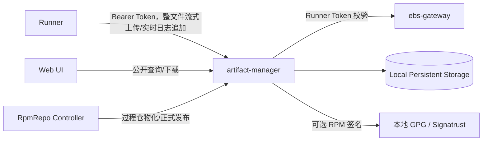

# Artifact Manager 设计

## 一、定位

Artifact Manager 是 EulerMaker 的构建结果数据服务，负责接收 Runner 上传的构建产物和日志，并提供查询、下载、保留与清理能力，同时提供 RPM 过程仓物化和正式仓库发布能力。过程仓物化和正式发布均由 Controller Manager 中的 RpmRepo Controller 驱动。

```text
Runner -> artifact-manager -> Local Persistent Storage

artifact-manager -> ebs-gateway Token authentication API
```

Artifact Manager 管理文件正文及其元数据，文件正文存储在本地持久化目录中。

可选 RPM 签名属于 Manifest 封账流程：上传完成后由服务端自动签名，成功后才提交最终清单；Runner 不调用独立签名接口。

## 二、设计目标

| 目标 | 说明 |
|------|------|
| 大文件上传 | 支持构建仓库、RPM、ISO 等大型产物 |
| 流式上传 | 单请求上传大文件，服务端流式落盘，不将完整文件载入内存 |
| 幂等 | 整文件上传请求可以安全重试，不生成重复 Artifact |
| 完整性 | 使用文件大小和 SHA-256 校验内容 |
| 持久化 | 文件正文和元数据存储在本地持久化目录 |
| 可扩展 | 支持实时日志，并为后续内容扫描预留扩展点 |

## 三、总体架构



Runner 直接访问 Artifact Manager，上传正文不经过 ebs-gateway，避免 Gateway 承担构建产物和日志文件带宽。Artifact Manager 通过 Gateway 校验 Token，并确认身份为 Runner，认证契约见第十一章。Artifact 查询和下载公开访问，不经过 Gateway 鉴权。

Artifact（包含上传幂等信息）和 Job 上传清单均以元数据文件形式存放在本地持久化目录，不依赖独立数据库。Artifact、LogStream 和 JobUploadManifest 元数据均按需读取，本地元数据文件是事实来源。

文件正文写入 Artifact Manager 管理的本地持久化目录。使用节点本地目录时只能部署单实例。

首版由 Runner 单请求上传完整文件，Artifact Manager 流式写入本地文件系统。首版不支持普通 Artifact 的分片传输和断点续传；请求中断后 Runner 使用相同幂等键重新上传整个文件。实时日志仍使用第十章定义的 chunk/sequence 追加协议，该协议用于实时展示和日志流恢复，不属于普通 Artifact 分片上传。

### 3.1 API 通信矩阵

下表中的路径是 Artifact Manager 或 Gateway 实际接收的路径；前端可经 Nginx 代理访问 Artifact Manager，但代理前缀不属于 Artifact Manager API。`{project}` 和 `{job}` 标识同一 Job。

| 调用方 → 接收方 | 方法与路径 | 用途 | 当前认证与访问约束 |
|---|---|---|---|
| Runner → Artifact Manager | `POST /artifacts/v1/projects/{project}/jobs/{job}/artifacts` | 上传产物 | Runner Bearer Token；Artifact Manager 向 Gateway 校验 |
| Runner → Artifact Manager | `POST /artifacts/v1/projects/{project}/jobs/{job}/manifest/complete` | 校验上传集合、按部署配置签名并封账 | Runner Bearer Token；Artifact Manager 向 Gateway 校验 |
| Runner → Artifact Manager | `POST /artifacts/v1/projects/{project}/jobs/{job}/logs/chunks` | 追加实时日志 | Runner Bearer Token；Artifact Manager 向 Gateway 校验 |
| Runner → Artifact Manager | `POST /artifacts/v1/projects/{project}/jobs/{job}/logs/complete` | 封账实时日志 | Runner Bearer Token；Artifact Manager 向 Gateway 校验 |
| Runner → Artifact Manager | `GET /artifacts/v1/projects/{project}/jobs/{job}/logs/status` | 查询日志流状态，恢复上传 | Runner Bearer Token；Artifact Manager 向 Gateway 校验 |
| Artifact Manager → Gateway | `POST /auth/check` | 验证 Runner Token 并获取 Runner 身份和过期时间 | 转发 Runner Bearer Token；调用方无独立服务凭据 |
| RpmRepo Controller → Artifact Manager | `POST /internal/v1/repositories` | 提交过程仓物化 | 暂无 Token 校验；仅限受信任的组件网络 |
| RpmRepo Controller → Artifact Manager | `GET /internal/v1/repositories/{repositoryUID}` | 查询过程仓状态 | 暂无 Token 校验；仅限受信任的组件网络 |
| RpmRepo Controller → Artifact Manager | `DELETE /internal/v1/repositories/{repositoryUID}` | 删除过程仓 | 暂无 Token 校验；仅限受信任的组件网络 |
| RpmRepo Controller → Artifact Manager | `POST /internal/v1/releases` | 提交正式发布 | 暂无 Token 校验；仅限受信任的组件网络 |
| BuildInfo Controller → Artifact Manager | `GET /repositories/{project}/{arch}/repodata/repomd.xml` | single 派发前确认稳定发布入口；尚未发布的精确语义见 9.3 | 公开只读，不经 Gateway 鉴权 |
| RpmRepo Controller → Artifact Manager | `GET /internal/v1/releases/{buildName}` | 查询正式发布状态 | 暂无 Token 校验；仅限受信任的组件网络 |
| RpmRepo Controller → Artifact Manager | `DELETE /internal/v1/releases/{buildName}` | 删除正式发布记录 | 暂无 Token 校验；仅限受信任的组件网络 |
| RpmRepo Controller → Artifact Manager | `POST /internal/v1/releases/{buildName}/activate` | 激活指定正式发布 | 暂无 Token 校验；仅限受信任的组件网络 |
| Runner、前端及其他读取方 → Artifact Manager | `GET /artifacts/v1/projects/{project}/jobs/{job}/manifest` | 查询 Job 上传清单 | 公开只读，不经 Gateway 鉴权 |
| Runner、前端及其他读取方 → Artifact Manager | `GET /artifacts/v1/projects/{project}/jobs/{job}/artifacts` | 列出 Job 产物 | 公开只读，不经 Gateway 鉴权 |
| Runner、前端及其他读取方 → Artifact Manager | `GET /artifacts/v1/projects/{project}/jobs/{job}/artifacts/{artifactID}/content` | 下载产物正文 | 公开只读，不经 Gateway 鉴权 |
| Runner、前端及其他读取方 → Artifact Manager | `GET /artifacts/v1/projects/{project}/jobs/{job}/logs/content` | 读取日志正文 | 公开只读，不经 Gateway 鉴权 |
| Runner、前端及其他读取方 → Artifact Manager | `GET /artifacts/v1/projects/{project}/jobs/{job}/logs/stream` | 订阅实时日志 | 公开只读，不经 Gateway 鉴权 |
| Runner、构建工具及其他读取方 → Artifact Manager | `GET /repositories/v1/{repositoryUID}/{path...}` | 读取过程仓文件 | 公开只读，不经 Gateway 鉴权 |
| Runner、构建工具及其他读取方 → Artifact Manager | `HEAD /repositories/v1/{repositoryUID}/{path...}` | 查询过程仓文件元数据 | 公开只读，不经 Gateway 鉴权 |
| Runner、构建工具及其他读取方 → Artifact Manager | `GET /repositories/{project}/{arch}/{path...}` | 读取当前正式仓文件 | 公开只读，不经 Gateway 鉴权 |
| Runner、构建工具及其他读取方 → Artifact Manager | `HEAD /repositories/{project}/{arch}/{path...}` | 查询当前正式仓文件元数据 | 公开只读，不经 Gateway 鉴权 |
| Runner、构建工具及其他读取方 → Artifact Manager | `GET /repositories/releases/v1/{buildName}/{path...}` | 读取指定发布版本的仓库文件 | 公开只读，不经 Gateway 鉴权 |
| Runner、构建工具及其他读取方 → Artifact Manager | `HEAD /repositories/releases/v1/{buildName}/{path...}` | 查询指定发布版本的仓库文件元数据 | 公开只读，不经 Gateway 鉴权 |
| 健康检查 → Artifact Manager | `GET /healthz` | 存活探测 | 无认证 |
| 健康检查 → Artifact Manager | `GET /readyz` | 就绪探测 | 无认证 |

各接口的请求、响应及错误语义见第六至十一章。内部管理接口尚未实现组件身份认证，部署时需限制访问来源；公开只读接口的访问边界由部署方控制。

### 3.2 实现分层

| 模块 | 职责与依赖 |
|---|---|
| `cmd/app` | 解析参数、校验启动配置、管理进程生命周期 |
| `pkg/server` | 装配业务模块，注册路由，处理 HTTP 协议与响应转换 |
| `pkg/upload` | Artifact、Manifest、日志及其本地存储；封账调用 server 注入的最小签名接口，不依赖仓库或发布模块 |
| `pkg/repository` | 过程仓物化；通过最小产物读取接口访问上传数据，由 server 注入 `upload.Store` |
| `pkg/release` | 正式发布与保留清理，依赖 repository 获取源仓，不直接管理上传记录 |
| `pkg/auth` | Gateway Token 校验和自动过期的认证缓存 |
| `pkg/signing` | RPM 签名后端、验签与指纹管理 |
| `pkg/fileutil` | 文件持久化、摘要和路径等底层文件操作 |

业务类型及配置随所属模块定义；底层模块不反向依赖 server。发布依赖过程仓、过程仓读取上传产物，但不建立跨模块的文件事务或活动引用保护。

### 3.3 并发与锁模型

以下为单可写实例的并发边界。“Job/日志流/仓库粒度”描述业务互斥范围，不代表实现了同名的独立互斥锁。

| 保护对象 | 当前同步方式 | 锁内操作与边界 |
|---|---|---|
| 普通上传请求 | Store 全局读写锁下登记 Pending，相同幂等作用域的进行中请求返回冲突 | 配额与路径检查、最终提交在 Store 锁内；网络正文流式写入不持有 Store 锁，不存在贯穿上传全程的独立键锁 |
| Artifact / Manifest 元数据 | `upload.Store` 全局读写锁；同一 Job 的封账执行去重 | 锁内冻结输入及提交清单；签名、验签和正文摘要计算在锁外执行，完成后重新核验冻结输入 |
| 封账签名 | 服务级有界 worker pool，默认 8 个 worker | 所有 Job 共用并发上限；队列有界，满载返回可重试错误，不持 Store 锁排队 |
| 日志流 | 同一个 Store 全局写锁 | chunk 追加、索引/汇总更新、恢复、重放和封账可能持锁执行文件 I/O；不同 Job 并非完全独立并发 |
| 过程仓任务 | Repository Manager 全局读写锁及 `queued/running` 集合 | 提交、去重、状态落盘和队列标记受锁保护；物化和外部命令在锁外运行，完成后重新检查状态 |
| 发布任务与 current | Release Manager 全局读写锁及任务集合 | 正文生成在锁外；状态提交与 current 切换在锁内，不同目标的激活也串行 |
| 鉴权、SSE | 认证缓存内部同步；订阅集合由 Store 锁保护 | 网络鉴权与 HTTP 流式发送不长期占用业务状态锁；慢订阅者断开，不反压上传 |

跨模块调用先获取源数据快照，再进入本模块的状态临界区；不在持有 Release Manager 锁时调用 Repository Manager，也不在持有 Store 或 Repository Manager 锁时执行签名命令。Store 不回调上层 Manager。当前不存在跨进程锁，多个可写实例不能共享同一数据目录。

正文生成与删除之间不通过持有全程锁来协调，具体竞态边界见 8.10。全局 Store 锁可能使慢磁盘、日志重放或封账影响其他 Job；细粒度锁优化属于后续工作，不能将配置的 worker 数直接等同于端到端并行度。

## 四、文件归属与存储键

产物由上传管理层关联到具体的一次 Job 执行。`project` 和 `jobName` 来自请求路径，唯一标识一次 Job，确定正文目录、Manifest 和日志流。Runner Token 用于上传认证；Artifact 本身只记录文件信息，不保存 Project、JobName 或 RunnerName。

存储键由服务端生成：

```text
projects/{project}/jobs/{jobName}/{safeRelativePath}
```

服务对 `relativePath` 进行词法规范化后生成 `safeRelativePath`，具体校验见 5.6。同一个 Job 中的 `safeRelativePath` 必须唯一，已存在时只有上传元数据相同的幂等重试可以返回原 Artifact。

本地后端以 `--data-dir` 为根目录，将存储键映射为正文路径。上传中的文件写入 `${dataDir}/.uploads/{artifactID}.tmp`，校验完成后在同一文件系统内原子重命名到最终路径。当前使用路径拼接及普通文件系统调用，部分读取会检查末级文件类型，但未实现以目录 FD 为根的全链路解析；父目录符号链接和检查后替换的竞态仍需加固。数据目录必须由服务独占写入，不允许不可信进程修改目录结构。

Artifact、日志流元数据和上传清单按 Job 聚合存储，普通产物及日志封账生成的 Artifact 使用相同目录结构：

```text
${dataDir}/.metadata/jobs/{project}/{jobName}/
├── artifacts/
│   └── {artifactID}.json
├── logs/
│   └── combined.json
├── seal.json                       # 冻结的封账输入、签名指纹和恢复进度
└── manifest.json
```

签名不覆盖原始上传正文。临时副本放在 `${dataDir}/.signing/{project}/{jobName}/`，验签并持久化后以不覆盖方式提交到 `${dataDir}/.signed/{project}/{jobName}/{artifactID}.rpm`。两者与仓库位于同一文件系统，均不是公开目录；最终清单决定下载和物化选择原始正文还是签名正文。封账发布边界及清理见 6.2.1。

Artifact 元数据按 Project、JobName、artifactID 直接定位文件，不保留全局 Artifact 缓存、归属索引或上传幂等索引。查询、配额、路径冲突和上传幂等判断只读取当前 Job 的 `artifacts/` 目录；Manifest 封账和物化读取按清单中的 ID 读取对应文件。元数据仅在本次调用期间保留，读写及检查后写入仍由 Store 锁串行保护。

启动时逐条扫描 Artifact 和 LogStream 元数据并执行恢复，处理完即释放，不将历史产物或日志流状态常驻内存。`manifest.json` 不在启动时加载，按 Project、JobName 定位读取，用完释放。

上传前及提交正文前，在 Store 锁内检查 Manifest 和封账记录；输入冻结后不再允许增加或完成新的上传，已完成 Artifact 的相同上传请求仍返回原始回执。只有文件不存在才视为无记录，JSON 损坏、归属不匹配和 I/O 错误均阻止写入。清单 GET 对尚未成功封账返回 404，对读取失败返回存储错误，不返回空清单。

元数据先写入临时文件并 `fsync`，再原子重命名，最后 `fsync` 父目录。首版只运行一个可写实例，避免在没有分布式锁的情况下并发修改同一 Artifact 或 Job 上传清单。

RPM 路径使用 `packages/{fileName}`，例如 `packages/kernel-6.6.rpm`。日志使用 `logs/` 作为一级目录。

## 五、数据模型

以下结构是首版持久化格式和 HTTP JSON 契约的基准。Go 实现可以增加不序列化的锁、文件句柄和内存索引字段，但不得改变已持久化字段的语义。请求 JSON 解码拒绝未知字段；持久化记录读取的校验范围见 5.6。

公共类型：

```go
type Timestamp = time.Time // JSON 使用 RFC3339Nano UTC，例如 2026-08-12T02:30:00.123Z

type ArtifactCategory string
const (
    ArtifactCategoryArtifact ArtifactCategory = "artifact"
    ArtifactCategoryLog      ArtifactCategory = "log"
)

type ArtifactState string
const (
    ArtifactPending   ArtifactState = "Pending"
    ArtifactCompleted ArtifactState = "Completed"
    ArtifactFailed    ArtifactState = "Failed"
)
```

### 5.1 Artifact

```go
type Artifact struct {
    SchemaVersion  int              `json:"schemaVersion"`
    ID             string           `json:"id"`
    Category       ArtifactCategory `json:"category"`
    FileName       string           `json:"fileName"`
    RelativePath   string           `json:"relativePath"`
    ContentType    string           `json:"contentType,omitempty"`
    Size           int64            `json:"size"`
    SHA256         string           `json:"sha256"`
    StorageKey     string           `json:"storageKey"`
    IdempotencyKey string           `json:"idempotencyKey,omitempty"`
    State          ArtifactState    `json:"state"`
    Failure        *FailureInfo     `json:"failure,omitempty"`
    CreatedAt      Timestamp        `json:"createdAt"`
    UpdatedAt      Timestamp        `json:"updatedAt"`
    CompletedAt    *Timestamp       `json:"completedAt,omitempty"`
}
```

`category` 首版支持：

| 值 | 说明 |
|----|------|
| `artifact` | RPM、仓库、ISO 等正式构建产物 |
| `log` | 完整日志文件 |

首版只接受 `artifact` 和 `log`，其他 category 返回 `422 UnsupportedArtifactCategory`。

普通 Artifact 上传的实际状态迁移：

```text
新请求 -> Pending -> Completed
             |
             +----> Failed
Failed -> Pending（相同上传元数据重试）
```

`Pending` 表示上传尚未完成，接收正文期间也保持该状态。
最终正文已提交但元数据未完成时，重试或启动恢复可补写 `Completed`，详见 6.1.2。
只有 `Completed` Artifact 可以公开下载。

`ID`、路径、大小、摘要、`StorageKey` 和 `IdempotencyKey` 创建后不可变；上传管理层维护的 Job 归属也不可变。`IdempotencyKey` 仅用于普通文件上传，由服务端根据请求填写；日志流封账产生的 Artifact 不设置。`Size` 必须大于等于 0；`SHA256` 是 64 位小写十六进制，不带 `sha256:` 前缀。`FileName` 用于展示，当前不校验其是否等于 `RelativePath` 的最后一段。`StorageKey` 仅由服务端生成，不接受客户端赋值，也不在普通列表响应中用于构造本地路径。

### 5.2 JobUploadManifest

Artifact Manager 使用本地持久化的 Job 上传清单记录一次 Job 的完整文件集合，不在 ebs-apiserver 中新增资源。单个 Artifact 的 `Completed` 只表示原始文件上传完整；`JobUploadManifest.Completed` 表示全部文件可用，且已完成部署配置要求的 RPM 签名和验签。

```go
type ManifestState string
const ManifestCompleted ManifestState = "Completed"

type ManifestFile struct {
    ArtifactID   string           `json:"artifactID"`
    RelativePath string          `json:"relativePath"`
    Category    ArtifactCategory `json:"category"`
    Size        int64            `json:"size"`
    SHA256      string           `json:"sha256"`
    Required    bool             `json:"required"`
}

type JobUploadManifest struct {
    SchemaVersion      int            `json:"schemaVersion"`
    Project            string         `json:"project"`
    JobName            string         `json:"jobName"`
    RunnerName         string         `json:"runnerName"`
    Files              []ManifestFile `json:"files"`
    Digest             string         `json:"digest,omitempty"`
    UploadDigest       string         `json:"uploadDigest"`
    SigningFingerprint string         `json:"signingFingerprint,omitempty"`
    State              ManifestState  `json:"state"`
    Failure            *FailureInfo   `json:"failure,omitempty"`
    CreatedAt          Timestamp      `json:"createdAt"`
    UpdatedAt          Timestamp      `json:"updatedAt"`
    CompletedAt        *Timestamp     `json:"completedAt,omitempty"`
    ExpiresAt          *Timestamp     `json:"expiresAt,omitempty"`
}
```

清单封账流程：

```text
无清单 -> 校验并冻结上传集合 -> 可选签名及验签 -> 原子提交 Completed
Completed -> Completed（相同原始上传集合的幂等请求）
```

每个 `(project, jobName)` 最多只能有一个 Manifest 成功进入 `Completed`；清单完成后不可增加、删除或替换文件。封账校验及重复请求行为见 6.2。

`uploadDigest` 对 Runner 提交的原始上传集合计算，用于完成请求重放和结果未知确认；`digest` 对最终 `files` 计算，用于验证封账内容。两者使用下述相同规范化算法；未启用签名时两者相等。`signingFingerprint` 是冻结输入时确定的部署公钥完整指纹，关闭签名时为空，调用方不能指定或覆盖。`Files` 中 RPM 的大小和摘要描述最终签名文件，其他条目保持原上传值；Artifact ID、路径、类别和 required 不变。原始 Artifact 元数据和上传回执保持不变，不用最终摘要覆盖上传幂等依据。

`Files` 至少包含一个条目，并按 `relativePath` 排序持久化；`artifactID` 和 `relativePath` 在清单内都必须唯一。输入校验失败不冻结集合，调用方可补传后重试；冻结后的签名失败保留封账恢复记录，不生成可供消费的 Manifest。Manifest 仅保留 `Completed` 状态，尚未成功封账时查询返回不存在，不代表此前完成请求已取消。

摘要输入逐项使用 UTF-8 编码，数字使用不带前导零的十进制，布尔值使用 `true/false`：

```text
artifact-manifest-v1\n
relativePath\0artifactID\0category\0size\0sha256\0required\n
...
```

`Digest` 和 `UploadDigest` 均表示为 `sha256:<64位小写十六进制>`。

### 5.3 LogStream

```go
type LogStreamState string
const (
    LogOpen       LogStreamState = "Open"
    LogFinalizing LogStreamState = "Finalizing"
    LogCompleted  LogStreamState = "Completed"
    LogFailed     LogStreamState = "Failed"
)

type LogChunkRecord struct {
    Sequence    int64  `json:"sequence"`
    StartOffset int64  `json:"startOffset"`
    Size        int64  `json:"size"`
    SHA256      string `json:"sha256"`
}

type LogStream struct {
    SchemaVersion  int            `json:"schemaVersion"`
    Project        string         `json:"project"`
    JobName        string         `json:"jobName"`
    RunnerName     string         `json:"runnerName"`
    Stream         string         `json:"stream"`
    State          LogStreamState `json:"state"`
    NextSequence   int64          `json:"nextSequence"`
    CommittedBytes int64          `json:"committedBytes"`
    ArtifactID     string         `json:"artifactID,omitempty"`
    FinalSize      *int64         `json:"finalSize,omitempty"`
    FinalSHA256    string         `json:"finalSHA256,omitempty"`
    Failure        *FailureInfo   `json:"failure,omitempty"`
    CreatedAt      Timestamp      `json:"createdAt"`
    UpdatedAt      Timestamp      `json:"updatedAt"`
    CompletedAt    *Timestamp     `json:"completedAt,omitempty"`
}
```

首版 `Stream` 只能是 `combined`。`NextSequence` 初始为 0，`CommittedBytes` 初始为 0。`LogChunkRecord` 使用 JSON Lines 追加式索引文件持久化，不在每次追加时整体重写进 `LogStream` JSON；记录必须满足 sequence 连续、offset 连续，且 `StartOffset+Size` 不超过 `CommittedBytes`。

索引文件每行是一个完整、紧凑的 JSON 对象，以单个 `\n` 结束，不允许空行、注释或跨行 JSON：

```jsonl
{"sequence":0,"startOffset":0,"size":1024,"sha256":"a1b2..."}
{"sequence":1,"startOffset":1024,"size":2048,"sha256":"c3d4..."}
```

字段顺序不是读取协议的一部分；实现必须按 JSON 字段名解析并拒绝未知字段。`sha256` 是对应 chunk 解压后正文的 64 位小写十六进制摘要。索引只能追加，不能就地修改已有记录。

### 5.4 上传幂等

整文件上传的幂等键保存在 Artifact 元数据中，不创建独立幂等记录。上传时在 Store 锁内读取当前 Job 的 Artifact 元数据，按 `idempotencyKey` 查找已有记录；相同作用域和 key 只能对应一个 Artifact，重启后仍能识别重复请求。

重复请求须与原 Artifact 的 `category`、`fileName`、规范化后的 `relativePath`、`contentType`、`size` 和 `sha256` 逐项一致；不比较 multipart boundary、header 顺序或文件正文。

创建 `Pending` Artifact 时必须持有 `(project,jobName,idempotencyKey)` 进程内锁，并先持久化元数据再读取正文。相同作用域和 key 的并发请求只能有一个进入正文读取阶段。`Failed` Artifact 保留幂等键，允许上传元数据相同的请求复用原 Artifact ID 整文件重传。

### 5.5 失败记录、错误和列表结构

`upload`、`repository`、`release` 各自定义 `FailureInfo`，不共享业务失败类型。
上传和发布的失败记录使用以下字段；过程仓的失败记录额外包含可选的
`JobName string`（`json:"jobName,omitempty"`），用于定位异常输入 Job。
各数据模型中的 `FailureInfo` 指所属业务包内的类型。

```go
type FailureInfo struct {
    Code      string    `json:"code"`
    Message   string    `json:"message"`
    Retryable bool      `json:"retryable"`
    Time      Timestamp `json:"time"`
}

type APIError struct {
    Code      string         `json:"code"`
    Message   string         `json:"message"`
    Retryable bool           `json:"retryable"`
    RequestID string         `json:"requestID"`
    Details   map[string]any `json:"details,omitempty"`
}

type ArtifactList struct {
    Items []Artifact `json:"items"`
}
```

API 错误响应的 `Content-Type` 为 `application/json`，客户端只能依赖稳定的 `code` 和结构化 `details`，不能解析 `message`。列表按 `(completedAt,id)` 升序返回该 Job 的全部 `Completed` Artifact，支持 `category` 过滤，当前不提供分页游标或文件名过滤。

### 5.6 通用格式与校验约束

| 字段 | 约束 |
|------|------|
| `schemaVersion` | 写入固定为 1；当前持久化记录读取不按版本拒绝记录，也不拒绝未知字段 |
| `id` | 服务端生成，Artifact 为 `art_` 加 16 个随机字节的小写十六进制编码 |
| `project`、`jobName` | 1–128 字节，仅允许字母、数字、`-`、`_`、`.`，不能为 `.` 或 `..` |
| `runnerName` | 来自 Gateway 认证结果，客户端请求正文不得提供 |
| `relativePath` | 拒绝绝对路径、反斜杠、NUL、CR、LF；Clean 后不得为 `.`、`..` 或以 `../` 开头，长度不超过 1024 字节；内部空段和可消解的 `..` 会被规范化 |
| `fileName` | 非空，不超过 255 字节 |
| `contentType` | 仅用于展示，不作为可信文件类型；当前无独立长度校验 |
| `size`、offset | `int64` 非负数，并受部署配额限制 |
| 单文件 SHA-256 | 64 位小写十六进制；Manifest digest 使用 `sha256:` 前缀 |
| `idempotencyKey` | 非空，不超过 128 字节；当前不额外校验字符集或空白，同一作用域内唯一 |

持久化记录的不可变字段不得通过更新接口修改。状态更新必须验证合法状态转换；失败记录不得包含 Token、文件正文、绝对本地路径或敏感签名材料。

### 5.7 HTTP 请求与响应结构

```go
type UploadArtifactMetadata struct {
    Category     ArtifactCategory `json:"category"`
    FileName     string           `json:"fileName"`
    RelativePath string           `json:"relativePath"`
    ContentType  string           `json:"contentType,omitempty"`
    Size         int64            `json:"size"`
    SHA256       string           `json:"sha256"`
}

type UploadArtifactResponse struct {
    Artifact Artifact `json:"artifact"`
}

type CompleteManifestRequest struct {
    Files  []ManifestFile `json:"files"`
}

type CompleteManifestResponse struct {
    State         ManifestState `json:"state"`
    ArtifactCount int           `json:"artifactCount"`
    Digest        string        `json:"digest"`
}

type LogStatusResponse struct {
    Stream         string         `json:"stream"`
    State          LogStreamState `json:"state"`
    NextSequence   int64          `json:"nextSequence"`
    CommittedBytes int64          `json:"committedBytes"`
    ArtifactID     string         `json:"artifactID,omitempty"`
    UpdatedAt      Timestamp      `json:"updatedAt"`
}

type CompleteLogRequest struct {
    Stream       string `json:"stream"`
    LastSequence int64  `json:"lastSequence"`
    Size         int64  `json:"size"`
    SHA256       string `json:"sha256"`
}

type CompleteLogResponse struct {
    State        LogStreamState `json:"state"`
    ArtifactID   string         `json:"artifactID"`
    RelativePath string         `json:"relativePath"`
    Size         int64          `json:"size"`
    SHA256       string         `json:"sha256"`
}

type SSELogData struct {
    Encoding string `json:"encoding"` // 固定为 base64
    Content  string `json:"content"`
}

type SSECompleteData struct {
    ArtifactID string `json:"artifactID"`
    Size       int64  `json:"size"`
    SHA256     string `json:"sha256"`
}
```

HTTP 路径中的 `{project}`、`{job}` 是归属来源，上传元数据不得重复提供或覆盖。Artifact 的 ID、状态、存储键和时间由服务端填写；Manifest 和 LogStream 的 `RunnerName` 来自认证结果。空文件使用长度为 0 的正文上传；空日志封账时 `lastSequence=-1`、`size=0`、`sha256` 为 SHA-256 空输入。JobUploadManifest 首版不允许空 `files`；没有需要归档文件的 Job 不创建 manifest，Job Status 不增加 artifactCount 或 artifactState 字段。

## 六、上传 API

Artifact API 使用独立前缀：

```text
/artifacts/v1
```

### 6.1 上传 Artifact

```http
POST /artifacts/v1/projects/{project}/jobs/{job}/artifacts
Authorization: Bearer <runner-token>
Idempotency-Key: <uuid>
Content-Type: multipart/form-data; boundary=...
```

请求按顺序包含 `metadata` 和 `file` 两个 form-data part。`metadata` 必须位于 `file` 之前，使用 `application/json`，结构为 `UploadArtifactMetadata`；`file` 使用 `application/octet-stream`：

```json
{
  "category": "artifact",
  "fileName": "kernel-6.6.rpm",
  "relativePath": "packages/kernel-6.6.rpm",
  "contentType": "application/x-rpm",
  "size": 183746291,
  "sha256": "d6f4..."
}
```

成功返回 `UploadArtifactResponse`：

```json
{
  "artifact": {
    "id": "art_01...",
    "state": "Completed",
    "relativePath": "packages/kernel-6.6.rpm",
    "size": 183746291,
    "sha256": "d6f4..."
  }
}
```

服务先验证 Runner Token、上传元数据和配额，再按 6.1.2 登记 Pending、流式接收并提交正文。普通上传不提供进度查询、断点续传或中止接口；Runner 保留本地文件，使用相同 `Idempotency-Key` 整文件重传。提交前后的失败处理以 6.1.2 为准，不能统一删除已经提交的最终正文。

Artifact 元数据持久化 `idempotencyKey` 和上传元数据，所在目录提供 Project 和 JobName，共同确定幂等作用域。相同键且上传元数据逐项一致时：已有 Artifact 为 `Completed` 则直接返回原结果；仍有上传请求进行中则返回 409 `UploadInProgress`；前次失败或中断则清理旧临时文件并允许整文件重传。相同键但上传元数据不一致时返回 409 `IdempotencyConflict`。

#### 6.1.1 Multipart 解析限制

首版 multipart 请求必须满足：

- 恰好包含一个名为 `metadata` 的 part 和一个名为 `file` 的 part，不允许额外、重复或嵌套 multipart part。
- `metadata` 必须是第一个 part，`file` 必须是第二个且为最后一个 part；服务必须在读取文件正文前完成 metadata、鉴权、配额和幂等检查。
- `metadata` 的 `Content-Type` 必须是 `application/json`，解码时拒绝未知字段和尾随 JSON 数据；正文大小不得超过 `--max-metadata-size`。
- `file` 的 `Content-Type` 必须是 `application/octet-stream`。multipart 文件名仅用于协议兼容，不能覆盖 metadata 中的 `fileName`。
- 单个 part 的 header 数量、单行长度和总大小受第十六章的内部常量限制，拒绝重复的 `Content-Disposition` 及 header 中的 NUL、CR、LF。
- 整个请求使用 `MaxBytesReader`，上限为 `max-file-size + max-metadata-size + 1 MiB`；文件正文最多读取声明大小加 1 字节，再核对实际大小和摘要。校验错误的 HTTP 分类见第十五章。
- 请求可以不带总 `Content-Length`，服务以实际流式读取和校验为准。
- file 正文允许为 0 字节；到达 multipart 结尾时实际大小必须严格等于 metadata.size。
- 临时文件使用服务端生成的 Artifact ID 并以独占方式创建，禁止覆盖现有临时文件，不使用客户端文件名拼接路径。
- HTTP 请求头读取超时为 10 秒；`--upload-timeout` 设置上传处理的 context 超时，当前未给正文读取设置独立 deadline，不能保证中断阻塞中的 `io.Copy`。最低上传速率限制尚未实现。

首个 metadata 或第二个 file part 的格式、顺序、header 校验失败返回 `400 InvalidMultipartRequest`；metadata 解码或字段校验失败返回 `422 InvalidArtifactMetadata`。文件读取异常、大小或摘要不符，以及 file 后仍有额外 part，返回 `422 ArtifactChecksumMismatch`，不统一返回 413。

#### 6.1.2 可恢复提交顺序

整文件上传不是跨多个文件的原子事务。实现必须使用以下固定、可重放的提交顺序，以最终正文的原子 rename 作为正文提交点：

1. 在 Store 锁内检查 `(project,jobName,idempotencyKey)` 并原子写入含上传元数据和最终 `StorageKey` 的 `Pending` Artifact；用 Pending 登记阻止重复上传，之后释放 Store 锁，锁范围见 3.3。
2. 以独占方式创建 `.uploads/{artifactID}.tmp`，流式写入并计算大小和 SHA-256。
3. 校验成功后对临时正文执行 `fdatasync`。
4. 重新获取 Store 锁并检查 Manifest，允许提交时将临时正文原子 rename 到最终 `StorageKey`，随后 `fsync` 最终正文的父目录；该 rename 是正文提交点。
5. 原子更新 Artifact 元数据为 `Completed`，设置 `CompletedAt` 并 `fsync` 元数据父目录。
6. 释放 Store 锁，返回成功响应。

步骤 4 之后任何失败都不能删除最终正文；服务应返回可重试错误，由相同幂等键请求或启动恢复流程补齐元数据。步骤 4 之前失败则关闭并删除临时正文，将 Artifact 标记为 `Failed`，允许上传元数据相同的请求整文件重传。

服务启动时逐条读取 Artifact 元数据，只校验带有幂等键且处于 `Pending` 的 Artifact 正文；`Completed` 和 `Failed` Artifact 读取后即释放，不在启动路径重新计算正文摘要。未完成上传按以下规则恢复：

| 现场状态 | 恢复动作 |
|----------|----------|
| Pending Artifact + 临时正文 | 删除临时正文，将 Artifact 标记为 Failed，允许上传元数据相同的请求整文件重传 |
| Pending Artifact + 最终正文 | 流式复核大小和 SHA-256；匹配则补写 Completed，不匹配则隔离正文，写 `state=Failed`、`failure.code=Corrupted` |
| 只有临时正文 | 超过 `--temporary-upload-ttl` 后删除 |

已完成上传的幂等重放仍须校验最终正文，不得仅凭 Completed 状态返回成功。全面历史完整性检查不阻塞启动；隔离目录中的正文只能由后台审计或管理员处理。

### 6.2 提交并完成 Job 上传清单

Runner 完成全部单文件上传后提交最终清单：

```http
POST /artifacts/v1/projects/{project}/jobs/{job}/manifest/complete
Authorization: Bearer <runner-token>
Content-Type: application/json
```

```json
{
  "files": [
    {
      "artifactID": "art-01...",
      "relativePath": "packages/kernel-6.6.rpm",
      "category": "artifact",
      "size": 183746291,
      "sha256": "d6f4...",
      "required": true
    }
  ]
}
```

请求中的大小和 SHA-256 始终来自原始上传回执，Runner 不负责生成或预测签名后的摘要。服务先在 Store 锁内对 `(project, jobName)` 执行输入校验，锁模型见 3.3：

1. Runner Token 仍然有效；使用 URL 的 Project 和 Job 定位元数据目录，已有 Manifest 的归属与该作用域一致。
2. 清单内路径唯一，每个 Artifact ID 均在该 Job 的 `artifacts/` 目录中解析；Artifact 本身不包含 project、jobName 字段。
3. 所有列入清单的 Artifact 均为 `Completed`，没有仍在提交的上传。
4. Artifact 的路径、大小和 SHA-256 与清单一致。
5. 该 Job 尚未由不同内容完成 Manifest。

验证成功后按 5.2 计算 `uploadDigest`，冻结输入与当前签名指纹，再按 6.2.1 完成签名和最终清单提交。请求同步等待，只有 `Completed` 落盘后返回 HTTP 200；不返回表示已封账的提前成功响应，也不增加独立签名接口或 Runner 签名开关。无 RPM 或关闭签名时直接完成普通封账。

相同 Job、相同 `uploadDigest` 的已完成请求返回原结果，不再次签名；不同输入返回 `409 ManifestConflict`。正在执行的同输入请求返回 `409 ManifestInProgress / retryable=true`，附 `Retry-After: 5`。签名队列满时返回 `503 SigningBusy / retryable=true`，同样附带重试提示。完成接口以 Project 与 Job 名称为幂等作用域，不增加独立幂等键。调用方退避重试仍受自身后处理总期限限制。

```json
{
  "state": "Completed",
  "artifactCount": 1,
  "digest": "sha256:final-content-digest",
  "uploadDigest": "sha256:original-upload-digest",
  "signingFingerprint": "<configured-full-public-key-fingerprint>"
}
```

清单完成后禁止为该 Job 创建或完成新的 Artifact 上传。该接口是一次 Job 产物集合的唯一封账边界，不能通过扫描当前已有 Artifact 推断上传是否结束。

#### 6.2.1 签名、提交与恢复

1. 校验通过后先原子持久化 `seal.json`，记录规范化的原始文件集合、`uploadDigest`、签名指纹及已完成文件的最终大小和摘要。它是内部恢复记录，不是另一个可选 Manifest；同一 Job 仅一个冻结输入，同输入失败可重试，不允许替换输入或密钥。
2. 释放 Store 锁，将 `category=artifact`、位于 `packages/` 下且扩展名为 `.rpm`（不区分大小写）的二进制 RPM 和 SRPM 纳入签名。其他产物和日志不签名；格式非法的 RPM 明确失败。只包含日志的清单无需调用签名后端。
3. 每个任务流式复核原始大小和摘要，创建不共享 inode 的私有副本，签名、验签并确认完整密钥指纹。复核 NEVRA、架构、来源 spec、Provides 和 Requires 未改变，计算最终大小和 SHA-256。签名后副本也受单文件和 Job 配额限制，不一次性读入内存。
4. 每个成功副本 fsync 后以不覆盖语义提交到 `.signed`，再原子保存该文件的恢复进度。已有副本只能经验签、身份及摘要核验后复用；已记录进度的副本丢失或损坏时明确失败，不重新签名替换。不能仅凭文件存在判断成功，也不能对已提交副本再次原地签名。
5. 所有文件成功后重新获取 Store 锁，核对冻结输入、签名指纹与全部最终文件，从最终元数据生成 Manifest。原子写入 `manifest.json` 是唯一发布点；此前签名副本不可公开下载或用于物化，之后不可变。原始 Artifact 保留供上传幂等校验，完成响应及后续 GET 返回相同 `uploadDigest` 和最终 `digest`。
6. 超时、断连、取消或崩溃不代表封账失败已确定。Runner 先 GET 唯一 Manifest：仅 `Completed` 且 `uploadDigest` 与本地原请求匹配才确认成功；404 时用原请求重试，不把签名后的文件摘要与本地未签名文件逐项比较。服务不因重复请求创建第二套签名任务。
7. 重启不加载历史 Manifest 常驻内存。下一次相同完成请求按需读取 `seal.json` 恢复，已提交 Manifest 优先返回；已提交签名副本但恢复记录未更新时核验后补记，未提交临时副本可重建。当前配置指纹与冻结指纹不一致时返回 `503 SigningConfigurationChanged / retryable=true`，等待恢复配置，不改签名策略。

签名命令不持 Store 全局锁。全服务共用默认 8 个 worker 和有界等待队列（内部默认 100 个文件任务），按容量逐项派发，不为每个 Job 新建完整 worker pool。排队不占单 RPM 签名超时，但计入本次封账请求总期限；`--upload-timeout` 同时限制服务端单次封账处理，Runner 的后处理总期限限制跨请求重试。服务停止时取消在途签名并保留恢复记录，不依赖退出前最后一次写入才能恢复。

| 封账失败 | 处理 |
|---|---|
| 原始清单与上传记录不匹配 | `422 ArtifactMismatch`；不冻结新输入，可补传后重试 |
| RPM 非法、签名验证失败或身份改变 | `422 PackageMetadataInvalid`、`SignedPackageVerificationFailed` 或 `SignedPackageMetadataMismatch`；不可自动重试，不提交 Manifest |
| 后端不可达、命令超时、临时 I/O 或磁盘不足 | `503 SigningBackendUnavailable`、`StorageError` 或 `InsufficientStorage`；`retryable=true`，保留输入及已核验副本 |
| 签名后超出文件或 Job 配额 | `413 ArtifactLimitExceeded`；不提交 Manifest，不退化为无签名 |

签名失败不改变业务执行结果，但 Runner 在后处理期限内不能确认封账成功时按现有规则将 Job 标记为失败。成功封账后清理 `seal.json` 和临时目录，不能清理仍被最终 Manifest 使用的 `.signed` 文件；失败时保留原始正文、已核验副本及恢复记录供重试。未登记成功的临时副本在请求结束时清理，崩溃遗留在同 Job 下次恢复时清理。此流程不新增 Artifact/Manifest TTL，现有清理边界见第十三章；未来按 Job 删除时必须一起清理原始文件、签名副本和恢复记录，并与封账提交互斥，避免迟到任务重新发布清单。已建硬链接的仓库不受原始或签名产物目录后续删除影响。

#### 6.2.2 签名后端

签名策略仅由 Artifact Manager 部署配置决定，Job、Project、Runner 和封账请求不能指定后端、程序或密钥。模式为 `disabled`（默认）、`local-gpg` 或 `signatrust`；不签名 `repomd.xml`、updateinfo 或任意代码文件。

本地模式调用固定的 `rpmsign --resign`。私钥和口令由 Artifact Manager 进程可访问，不构成独立隔离边界；密钥以受限权限挂载，口令从受保护文件或签名代理读取，不通过参数、普通环境变量或日志传播。Signatrust 模式调用客户端的 RPM/PGP 签名能力（`--file-type rpm --key-type pgp`），地址、TLS 凭据及 `key-name` 固定于部署配置，私钥由远端平台持有；客户端传送 RPM 正文产生的网络流量仍然存在。两种后端均使用参数数组、受限环境和超时，不拼接 shell 命令。

`--release-public-key` 提供签名验证使用的公钥。启动配置无效时拒绝启动；签名结果必须使用该公钥验证并核对完整指纹。指纹在封账时冻结，后端名称不写入 Manifest；相同指纹允许切换实现后端。密钥轮换应等待在途 Build 结束，跨密钥继承需从空基础仓重新完整构建。物化及正式发布的指纹一致性规则见 8.7.1。

### 6.3 查询 Job 上传清单

```http
GET /artifacts/v1/projects/{project}/jobs/{job}/manifest
```

接口返回该 Job 唯一清单的状态、最终文件列表、`uploadDigest`、`digest` 和签名指纹。仓库物化只使用 `Completed` 清单；RpmRepo Controller 不预查该接口，也无需记录摘要。Runner 使用 `uploadDigest` 确认原始封账意图，其他消费者使用最终文件元数据。消费者不得直接读取本地元数据文件。

## 七、查询与下载 API

Artifact 查询、列表和下载不要求登录，也不执行 Project 权限检查。任何能够访问 Artifact Manager 的客户端都可以查询 Completed Artifact 并获取下载地址。

### 7.1 查询 Job 产物

```http
GET /artifacts/v1/projects/{project}/jobs/{job}/artifacts
```

返回该 Job 的全部 Completed Artifact，支持按 `category` 过滤；排序和列表结构见 5.5。

已封账 Job 的列表按 Manifest 投影：签名 RPM 保持 Artifact ID 和逻辑路径，大小、SHA-256 使用最终值；非签名文件不变。未封账时仍可查询、下载已上传的原始文件，但这些文件尚不具备封账可用性。普通上传接口的重复请求始终返回原始上传回执，与封账后的下载投影区分。

### 7.2 下载文件

```http
GET /artifacts/v1/projects/{project}/jobs/{job}/artifacts/{artifactID}/content
```

正文接口支持 `Range`、`ETag`、`If-None-Match` 和 `Content-Disposition`。Artifact Manager 流式读取文件并返回，下载过程中不得将完整文件载入内存。

封账后，签名 RPM 的相同下载 URL 读取 `.signed` 中的最终文件，`Content-Length`、Range 和 ETag 均依据该文件；每个请求固定正文和元数据快照，禁止混用签名前后的大小和摘要。最终文件缺失或损坏时返回错误，不回退未签名正文。过程仓产物读取接口使用相同的最终内容选择规则。

公开查询和下载是系统明确的数据访问策略。部署方必须通过网络边界决定 Artifact Manager 是否向公网开放，并为公开接口配置请求速率和下载带宽限制。

## 八、RPM 仓库物化

### 8.1 定位

Artifact Manager 在已经接管 Job 构建产物的基础上，提供 RPM 仓库物化能力。Controller Manager 中的 RpmRepo Controller 负责持续感知构建结果、选择基础仓和输入 Job，并只更新 `RpmRepo.status`；Artifact Manager 只负责校验固定版本的 Job 上传清单、组织 RPM、生成 repodata、原子发布仓库正文和保存本地物化状态。

```text
RpmRepo Controller
    │ 选择 base repository 和 Completed manifests
    ▼
Artifact Manager
    │ 校验清单与 RPM，继承基础仓，替换本批次 spec
    │ 执行 createrepo_c，在本地原子发布不可变仓库
    ▼
Repository content URL
    │
    └── RpmRepo Controller 更新 RpmRepo.status
```

该能力替代老 repo-manager 的 Job JSON 目录扫描、ES 直接写入和 etcd 队列通知。控制面与数据面的职责边界见 8.3。

### 8.2 设计目标

1. 从一个显式基础仓和一组已封账的 Job 上传清单生成完整 RPM 仓库。
2. 同一请求可安全重试，不重复生成仓库或重复替换内容。
3. 新仓库发布前不可见；成功后内容不可变。
4. 同一 spec 的新产物完整替换基础仓中的旧产物。
5. 复用本地 Artifact 正文，避免控制器下载再上传大文件。
6. 进程崩溃后能够区分 Ready、可继续清理的临时状态和失败状态。
7. 仓库生成不直接修改业务 API 对象，避免数据面与控制面形成双写事务。

当前实现不提供 `repomd.xml` 签名、跨 Artifact Manager 实例复制、镜像同步、增量 delta RPM 或外部仓库导入。可选 RPM 签名在 Manifest 封账时按 6.2 执行；物化只消费最终产物，指纹约束见 8.7.1。

### 8.3 职责边界

#### 8.3.1 RpmRepo Controller

RpmRepo Controller 负责选择基础仓与输入 Job、持久化推进意图，以及更新业务 API 状态；详细规则统一见 [RpmRepo Controller 设计](controller-manager~rpmrepo-controller.md)，本节仅保留调用契约。

#### 8.3.2 Artifact Manager

Artifact Manager 负责校验固定输入、执行 8.7 的物化算法，保存本地状态并提供内容下载；失败及重启恢复见 8.9。输入或基础仓已因保留策略删除时返回稳定失败。

Artifact Manager 不监听 Job，不访问 ebs-apiserver、Elasticsearch 或 etcd，不更新 `RpmRepo`、`Build` 或 `Job`，也不提供隐式“取最新仓库”接口。过程仓物化不维护可变的 `last`、`current` 软链接，调用方必须使用返回的不可变仓库 URL；第九章正式发布的 `current` 只属于稳定发布入口，不参与过程仓版本选择。

#### 8.3.3 控制面调用契约

仅非 single 的 Build Controller 创建 RpmRepo；RpmRepo Controller 选择基础仓和输入 Job，持久化检查点，再调用本章内部接口并根据结果更新 `RpmRepo.status`。不发布构建的处理、批次选择、发布门禁及控制面重启恢复统一见 [RpmRepo Controller 设计](controller-manager~rpmrepo-controller.md)。

Artifact Manager 校验每个输入的 Completed Manifest。可定位的输入错误通过 `failure.jobName` 返回，供调用方跳过异常输入并重新组批；服务端状态与错误契约分别见 8.5、8.6.5 和 8.9。

### 8.4 标识与存储布局

一个 RpmRepo 是可持续推进的逻辑仓库，其 `metadata.uid` 不能直接作为物理版本标识。每次推进根据 Project、Build name、`baseRepositoryUID` 和按字典序排列的全部输入 Job 名称计算 SHA-256，将其十六进制结果作为稳定 `repositoryUID`。Build name 本身由唯一 UUID 生成且不复用。相同批次重试自然复用同一幂等键；基础仓或批次成员变化一定生成不同的不可变版本。摘要编码必须使用带长度前缀的字段序列，避免字符串拼接歧义。

```text
${dataDir}/
├── repositories/
│   └── {project}/
│       └── {arch}/
│           ├── current -> releases/{buildName}
│           ├── Packages -> current/Packages
│           ├── repodata -> current/repodata
│           ├── RPM-GPG-KEY-openEuler -> current/RPM-GPG-KEY-openEuler
│           ├── releases/
│           │   └── {buildName}/
│           │       ├── Packages/
│           │       ├── repodata/
│           │       └── release.json
│           └── history/
│               └── {buildName}/
│                   └── steps/
│                       └── {repositoryUID}/
│                           ├── Packages/
│                           ├── repodata/
│                           └── repository.json
├── .repository-work/
│   └── {repositoryUID}-{random}/
├── .release-work/
│   └── {buildName}-{random}/
├── .repository-trash/
├── .release-trash/
└── .metadata/
    ├── repositories/
    │   └── {repositoryUID}.json
    └── releases/
        └── {buildName}.json
```

`project`、`arch` 和 Build name 作为仓库的存储分区参与路径拼接，必须先通过标识符校验；`repositoryName` 只属于元数据，不直接参与本地路径拼接。文件系统访问的当前保护及边界见第四章。

`history/{buildName}/steps/{repositoryUID}` 保存构建过程中逐批推进的不可变仓库版本。`steps` 只是存储组织层级，最新版本仍以 `RpmRepo.status.repository.repositoryUID` 为唯一权威，禁止扫描目录、比较修改时间或按 UID 排序推断最新版本。

`releases/{buildName}` 保存正式发布产生的不可变版本；架构根目录的 `Packages` 和 `repodata` 是稳定发布入口，由第九章的正式发布流程以原子切换方式维护。RpmRepo 过程仓物化不得创建或修改 `releases`、根目录链接及 `RPM-GPG-KEY-openEuler`。启用内置签名时，新 RPM 已在 Manifest 封账前签名；物化和正式发布均复用最终 RPM，不重新签名。正式发布安装匹配的公钥，不签名 `repomd.xml`。

Ready 过程仓目录不可修改。创建新版本时必须使用新的 `repositoryUID`，并通过 `baseRepositoryUID` 显式引用基础仓；Artifact Manager 根据基础仓元数据中的 Project、架构和 Build name 定位其实际目录，调用方不得传递本地路径。

### 8.5 数据模型

控制面 RpmRepo 的类型统一见 [数据模型](data-models.md)，推进与恢复规则见 [RpmRepo Controller 设计](controller-manager~rpmrepo-controller.md)。本节只定义 Artifact Manager 的请求、持久化记录和对外响应；其状态不等同于控制面 RpmRepo 的状态。

```go
type RepositoryState string

const (
    RepositoryCreating RepositoryState = "Creating"
    RepositoryReady         RepositoryState = "Ready"
    RepositoryFailed        RepositoryState = "Failed"
    RepositoryDeleting      RepositoryState = "Deleting"
)

type ManifestReference struct {
    JobName    string `json:"jobName"`
}

type CreateRepositoryRequest struct {
    RepositoryUID    string              `json:"repositoryUID"`
    RepositoryName   string              `json:"repositoryName"`
    Project          string              `json:"project"`
    BuildName        string              `json:"buildName"`
    TargetArch       string              `json:"targetArch"`
    BaseRepositoryUID string             `json:"baseRepositoryUID,omitempty"`
    Manifests        []ManifestReference `json:"manifests"`
}

type RepositoryRecord struct {
    SchemaVersion      int                 `json:"schemaVersion"`
    RepositoryUID      string              `json:"repositoryUID"`
    RepositoryName     string              `json:"repositoryName"`
    Project            string              `json:"project"`
    BuildName          string              `json:"buildName"`
    TargetArch         string              `json:"targetArch"`
    BaseRepositoryUID  string              `json:"baseRepositoryUID,omitempty"`
    Manifests          []ManifestReference `json:"manifests"`
    RequestDigest      string              `json:"requestDigest"`
    SigningFingerprint string              `json:"signingFingerprint,omitempty"`
    State              RepositoryState     `json:"state"`
    Attempt            int                 `json:"attempt"`
    RepositoryDigest   string              `json:"repositoryDigest,omitempty"`
    ContentURL         string              `json:"contentURL,omitempty"`
    RPMs               map[string]RepositoryRPMMeta `json:"rpms,omitempty"`
    Failure            *FailureInfo        `json:"failure,omitempty"`
    CreatedAt          Timestamp           `json:"createdAt"`
    UpdatedAt          Timestamp           `json:"updatedAt"`
    CompletedAt        *Timestamp          `json:"completedAt,omitempty"`
}

type RepositoryResponse struct {
    RepositoryUID     string              `json:"repositoryUID"`
    State             RepositoryState     `json:"state"`
    Attempt           int                 `json:"attempt"`
    PollAfterSeconds  int                 `json:"pollAfterSeconds,omitempty"`
    ContentURL        string              `json:"contentURL,omitempty"`
    Failure           *FailureInfo        `json:"failure,omitempty"`
    CreatedAt         Timestamp           `json:"createdAt"`
    UpdatedAt         Timestamp           `json:"updatedAt"`
    CompletedAt       *Timestamp          `json:"completedAt,omitempty"`
}
```

请求摘要由规范化后的全部请求字段计算。`Manifests` 先按 `JobName` 排序；重复引用、空输入、重复 `JobName` 或不合法 Job 名称均返回 `422`。Artifact Manager 还必须重新计算并校验 `repositoryUID` 与规范化请求一致。相同 `repositoryUID` 和相同请求摘要是幂等重试；相同 UID 对应不同摘要返回 `409 RepositoryIdentityConflict`。

`RepositoryRPMMeta` 记录文件名、SHA-256、大小、RPM name、epoch/version/release、arch、source RPM、specName、provides 和 requires。键使用仓库内唯一文件名。RPM 明细持久化在不可变的 `repository.json` 中，`.metadata/repositories` 只保存轻量状态，不重复存储该字段。

### 8.6 内部 API

RpmRepo Controller 通过以下内部物化接口请求仓库生成，不访问 Artifact Manager 的私有 `${dataDir}`，也不通过 Artifact 下载接口逐个下载 RPM 后在 Controller Manager 本地生成仓库。

过程仓管理接口成功返回 `RepositoryResponse`，业务失败返回第五章的 JSON `APIError`。`code` 用于机器判断，`message` 供诊断，`retryable` 表示是否可重试。错误正文的 `requestID` 取自请求的 `X-Request-ID`，当前不自动生成 ID 或统一设置响应头。调用通用方法检查的入口在方法不支持时返回文本格式的 405；其他路由也可能返回 404，不能假定所有错误均为 JSON。队列满返回整数秒 `Retry-After: 5`；调用方优先使用该 header，否则采用自身指数退避。

`attempt` 从 1 开始，只在服务端接受一次新的执行尝试时增加。查询、相同请求的并发提交以及 Ready 结果重放均不增加。`pollAfterSeconds` 只在 `Creating` 时返回，首版固定为 5；它是轮询下限，不是完成期限。

#### 8.6.1 提交物化

```http
POST /internal/v1/repositories
Content-Type: application/json
```

请求体中的确定性 `repositoryUID` 同时作为物化操作的幂等键，不再要求额外的 `Idempotency-Key` 请求头。

处理规则：

| 条件 | HTTP 状态 | 响应与行为 |
|------|-----------|------------|
| 首次接受 | `202 Accepted` | 原子持久化 `Creating, attempt=1` 后入队，返回 `RepositoryResponse` 和 `Location: /internal/v1/repositories/{repositoryUID}` |
| 相同请求正在执行或排队 | `202 Accepted` | 返回原 `Creating`，不重复入队、不增加 attempt |
| 相同请求已经 Ready | `200 OK` | 返回原 Ready 结果 |
| 相同请求处于可重试 Failed | `202 Accepted` | 原子增加 attempt、清空旧 Failure、写为 Creating 后重新入队 |
| 相同请求处于不可重试 Failed | `200 OK` | 返回原 Failed 结果，不重新执行 |
| 相同 UID、不同请求摘要 | `409 Conflict` | `RepositoryIdentityConflict` |
| 请求字段非法、UID 计算不一致或 Manifest 引用重复 | `422 Unprocessable Entity` | 返回对应稳定错误，不创建记录 |
| 接受前已确认 Manifest、Artifact 或基础仓过期 | `410 Gone` | `MaterializationInputExpired`，不创建或推进 attempt |
| 内存待执行队列已满 | `429 Too Many Requests` | `RepositoryQueueFull`、`retryable=true` 和 `Retry-After: 5`；不得先创建 Creating 记录 |
| 服务正在关闭、元数据存储暂不可用 | `503 Service Unavailable` | 稳定错误、`retryable=true` 和 `Retry-After` |

只有成功持久化 Creating 记录后才能返回接受成功并入队。入队与记录写入不是单一事务；启动恢复载入活动记录后，Manager 每 5 秒检查内存中的 Creating 记录，重新入队既未排队也未运行的任务，避免重复执行；该检查不是全量磁盘扫描。响应不等待 `createrepo_c` 完成。

#### 8.6.2 查询状态

```http
GET /internal/v1/repositories/{repositoryUID}
```

存在记录时统一返回 `200 OK` 和 `RepositoryResponse`：

- `Creating` 包含 attempt 和 `pollAfterSeconds`；
- `Ready` 必须包含不可变的 `contentURL` 和 `completedAt`；仓库响应不返回 RPM 元数据，完整元数据保留在内部 RepositoryRecord 和 repository.json 中；
- Controller 按预期的 `repositoryUID` 与 `Ready` 确认过程仓；正式发布按预期的 `buildName` 与 `Ready` 确认。内容摘要仅保留在 Artifact Manager 内部记录和索引文件中，用于完整性校验与重启恢复，不写入 RpmRepo 状态，也不在仓库或发布响应中返回。
- `Failed` 必须包含 attempt 和 Failure，且 `Failure.retryable` 明确能否用完全相同的 POST 请求重试；
- `Deleting` 只返回身份、状态和时间字段，不再返回可用内容地址。

记录不存在时返回 `404 Not Found / RepositoryNotFound`。GET 从不改变状态或 attempt。

#### 8.6.3 删除仓库

```http
DELETE /internal/v1/repositories/{repositoryUID}
```

删除是异步、幂等操作，不检查仓库是否正被物化任务读取：

| 条件 | HTTP 状态 | 响应与行为 |
|------|-----------|------------|
| Creating、Ready 或 Failed | `202 Accepted` | 原子写为 Deleting，取消同 UID 的排队任务；运行任务不要求立即中断，最终发布前必须因状态不再是 Creating 而放弃发布 |
| 已经 Deleting | `202 Accepted` | 返回原 Deleting，不重复创建清理任务 |
| 记录不存在或删除已完成 | `204 No Content` | 视为删除成功 |

DELETE 不使用请求体。进入 Deleting 后，相同 UID 的 POST 返回 `409 Conflict / RepositoryDeleting`，不能通过重提物化请求撤销删除。Artifact Manager 不因 Project、Build 或 RpmRepo API 对象删除而自行推断清理；保留期限到达或显式删除请求均可直接推进删除。

#### 8.6.4 仓库内容

```http
GET /repositories/v1/{repositoryUID}/{path...}
```

只为 `Ready` 仓库提供只读内容。Creating 返回 `409 RepositoryNotReady`，Failed 和 Deleting 返回 `410 RepositoryUnavailable`，未知 UID 返回 404。路径必须经过规范化并限制在仓库目录中，支持 `GET`、`HEAD`、单区间 `Range`、`ETag` 和条件请求；不支持多区间 Range，目录列表关闭。`ETag` 使用目标文件 SHA-256 的强校验值。部署方可通过网络边界决定是否公开该接口。

当前内部管理 API 暂不执行 Token 校验，只能暴露在受信任的组件网络中，并通过网络策略限制为 Controller Manager 访问。后续接入统一的组件身份认证时再增加认证，不改变接口业务语义。

#### 8.6.5 错误分类与停机

以下错误不可使用相同 UID 自动重试：请求或身份冲突、Manifest 内容非法、RPM 无法解析、包冲突、架构不兼容、输入已经过期以及本地文件系统布局不满足硬链接要求。单个 Job 的清单、RPM 或产物错误在失败记录的 `failure.jobName` 中标明对应输入；无法归属到单个 Job 时留空。命令超时、`createrepo_c` 临时失败、瞬时 I/O 错误和磁盘空间不足标记为 `retryable=true`；调用方仍必须遵守退避，不能无限快速重试。服务端错误信息不得包含本地绝对路径、Token 或命令环境。

停机先调用 HTTP `Shutdown`，在 `--shutdown-timeout` 内等待活动 HTTP 请求结束，随后关闭服务并取消后台 Manager context。当前不等待后台 worker 全部退出，也不保证退出前持久化中断状态；未完成任务依靠下次启动恢复。探针行为见第十七章。

进程崩溃可能留下 Creating 记录。启动恢复若发现完整且校验通过的最终目录则补写 Ready；否则保持 Creating 并重新入队，过期工作目录按恢复宽限期清理。启动扫描及恢复初始化在 HTTP 监听前完成，不等待重新入队的任务全部执行完毕。

### 8.7 物化算法

单次物化按以下顺序执行：

1. 在 Repository Manager 锁内校验或创建并持久化 `Creating` 的 `RepositoryRecord`，通过队列和运行标记保证同一 UID 至多一个物化任务；正文生成在锁外执行，见 3.3。
2. 校验基础仓存在且为 `Ready`，并且 Project 和架构与请求一致。
3. 按 Job 名称逐个读取唯一的 Job 上传清单，要求状态为 `Completed`，并在 Artifact Manager 内部重新计算清单摘要以验证本地元数据完整性。
4. 每个输入 Job 至少包含一个 `relativePath` 位于 `packages/` 下且以 `.rpm` 结尾的 Artifact；通过产物读取接口取得 Manifest 指定的最终文件，流式计算 SHA-256 并与最终清单比对，不与原始上传摘要混用。缺少 RPM、清单损坏或输入产物过期时在失败记录中标明该 Job 名称。
5. 使用 RPM 解析工具读取头信息，确定 `specName`。二进制 RPM 从 `SOURCERPM` 文件名末尾的版本、发行号分隔符推导源包名，不要求它与子包版本一致；source RPM 使用自身名称推导，并按 `src` 架构建立仓库身份，即使 RPM 头中报告了构建目标架构。无法确定归属时记录出错的 Job 名称并使本次请求失败。
6. 同一请求内同一 spec 可以产生多个 RPM，但同一仓库文件名只能对应一个摘要；同名不同内容、同一 NEVRA 不同内容或目标架构不兼容均返回 `422 PackageConflict`。源码包与同名同版本的二进制包不视为同一 NEVRA。
7. 在 `.repository-work/{repositoryUID}-{random}` 创建工作目录。
8. 基础仓存在时，读取其不可变 `repository.json` 中的 RPM 元数据，只将非本批输入 spec 的旧 RPM 硬链接到工作目录，并复制 `repodata` 供 `--update` 复用；校验目录项与元数据一致，但不重新解析或哈希旧 RPM。基础仓和工作目录必须位于同一文件系统；硬链接失败不静默退化为完整复制。
9. 按 8.7.1 检查输入和基础仓的签名指纹，将本批最终 RPM 硬链接到工作目录；最终产物与仓库工作目录必须位于同一文件系统。物化不调用签名后端，不修改原始上传、最终产物或基础仓硬链接。
10. 执行 `createrepo_c --update`。命令使用参数数组而非 shell 拼接，设置超时、固定 locale 和受限环境。失败时记录稳定错误码，不向调用方返回原始命令输出。
11. 确认生成的 `repodata/repomd.xml` 存在且为普通文件。
12. 计算本次最终内容的 `repositoryDigest`：按仓库相对路径排序，对每个文件的路径、大小和 SHA-256 编码后计算整体 SHA-256；RPM 复用已校验的基础仓元数据或本批 Manifest 的最终 RPM 摘要，其他文件现场计算摘要。物化重试始终读取同一封账版本，不重新生成签名字节。
13. 写入并 fsync `repository.json`，再将工作目录以不覆盖语义原子重命名为最终目录。
14. 原子写入 `Ready` 元数据，并向等待该 UID 的请求广播完成。

任何一步失败都不得暴露工作目录为可下载仓库，也不得修改基础仓或输入 Artifact。

#### 8.7.1 已签名产物的一致性

签名与验签在 6.2 的封账流程中完成。首次接受物化时仍将当前配置公钥的完整指纹冻结到 `RepositoryRecord.SigningFingerprint` 与 `repository.json`，关闭签名时为空；它不由请求提供，也不改变 `repositoryUID` 计算规则。

本批每个 Manifest 的签名指纹以及基础仓指纹必须与记录一致，包括空指纹；不允许混入未签名产物、其他密钥签名产物，或在物化时临时补签。首次无基础仓可直接使用符合策略的最终清单。所有本批文件按 Manifest 最终摘要校验，之后与基础仓文件一样只读复用。

相同 UID 的未完成任务只在当前部署指纹与冻结记录一致时恢复，否则使用 `SigningConfigurationChanged / retryable=true` 等待配置恢复。Ready 重放返回原结果。正式发布核对源仓指纹与配置公钥一致，不重复签名。物化失败只处理仓库工作目录，不删除或改写封账产物。

### 8.8 并发和一致性

- 同一 `repositoryUID` 同时最多一个物化任务；状态提交受 Manager 锁保护，删除与在途任务的交互按 8.10 处理。状态查询和 Ready 内容读取可与正文生成并发。
- 不同仓库可以并发物化，即使它们引用同一个 Ready 基础仓；基础仓不可变，因此读取无需串行化。
- 清理与物化之间不建立引用或锁协调；生命周期总则见第十三章，仓库删除并发语义见 8.10。
- `baseRepositoryUID` 必须指向已经 Ready 的仓库，禁止引用 Creating、Failed 或自身；由此仓库依赖图保持无环。
- 多个请求可以从同一基础仓产生不同分支；某个 Build 的唯一后续版本由 8.3.3 的控制面串行推进及恢复契约确定。

### 8.9 失败、重试和恢复

| 场景 | 处理 |
|------|------|
| 清单不存在或未 Completed | 标记 `Failed / ManifestNotReady / retryable=false`，记录对应 `jobName`，不发布目录 |
| 清单 JSON 损坏或归属不匹配 | 标记 `Failed / ManifestInvalid / retryable=false`，记录对应 `jobName` |
| 清单读取发生 I/O 错误 | 标记 `Failed / StorageError / retryable=true`，记录对应 `jobName`，允许重试 |
| 基础仓不存在或不是 Ready | `422 BaseRepositoryNotReady` |
| 同 UID 不同请求 | `409 RepositoryIdentityConflict` |
| RPM 非法或 spec 无法识别 | 标记 `Failed / PackageMetadataInvalid / retryable=false`，记录对应 `jobName` |
| 硬链接返回跨文件系统 | 标记 `Failed / RepositoryFilesystemMismatch / retryable=false` |
| `createrepo_c` 超时或取消 | 标记 `Failed / RepositoryCommandTimeout / retryable=true`，不发布目录 |
| `createrepo_c` 执行失败 | 标记 `Failed / RepositoryCommandFailed / retryable=true`，不保存原始 stdout/stderr，不发布目录 |
| 输入清单或基础仓签名指纹不匹配 | `ManifestSigningMismatch` 或 `BaseRepositorySigningMismatch`，`retryable=false`；清单错误记录来源 `jobName`，不发布目录 |
| 未完成物化记录的指纹与当前配置不一致 | 标记 `Failed / SigningConfigurationChanged / retryable=true`，保留原指纹，不发布目录 |
| 磁盘空间不足 | 标记 `Failed / InsufficientStorage / retryable=true`，不发布目录 |
| 输入 Manifest、Artifact 或基础仓在物化期间到期删除 | 标记 `Failed / MaterializationInputExpired / retryable=false`，不发布目录 |
| 停机或崩溃中断 | 不保证写入统一的中断状态；下次启动按持久化的 Creating 记录恢复 |
| 提交响应丢失 | 调用方使用相同 UID 查询；禁止生成新 UID 盲目重试 |
| 状态查询暂时失败 | RpmRepo Controller 指数退避，不重复提交不同请求 |
| API 状态更新失败 | 仓库保持 Ready，RpmRepo Controller 继续重试 API 更新 |

服务启动时扫描 `.metadata/repositories` 的 UID 和状态，只把 `Creating`、`Deleting` 记录载入内存以恢复任务。Ready 和 Failed 记录不常驻内存，按 UID 查询时从轻量元数据文件读取，用完即可回收。读取 Ready 记录时检查 `repository.json` 是否存在；缺失时本次请求视为 `RepositoryContentMissing`，不提供内容或基础仓引用。

对于 Creating 记录，若最终目录中的 `repository.json`、请求摘要及目录摘要均校验通过，则补写 Ready；否则保持 Creating 并重新入队。Deleting 记录继续删除。`.repository-work` 中超过恢复宽限期的目录按过期时间清理。Ready 仓不在启动时逐个重算目录摘要，发布任务需要 RPM 明细时才读取其 `repository.json`。

恢复扫描完成前 HTTP 服务尚未监听，探针行为见第十七章。

### 8.10 清理与保留

仓库和 Artifact 生命周期按第十三章独立管理。仓库中的 RPM 使用硬链接后拥有独立目录项，删除原 Artifact 不会破坏 Ready 仓库。若删除与物化并发，已经打开的文件或已经建立的硬链接仍可继续使用；其他读取可能失败，物化任务必须终止且不得发布半成品。

删除顺序：

1. 将记录持久化为 `Deleting`，拒绝新的内容请求和基础仓引用；
2. 把最终目录原子移动到内部 trash 目录；
3. 删除 trash 中的目录，再移除元数据和内存记录。

当前只持久化 `Deleting` 状态，未记录带随机后缀的 trash 路径，也未检查后续递归删除及元数据删除的错误。重启会重试 Deleting 记录，但不能保证清除上次已移动的 trash；崩溃或删除失败可能留下孤儿目录，可靠删除的补全见第十八章。

### 8.11 验收场景

1. 无基础仓时从多个 Completed Manifest 生成可被 DNF 使用的首个物理版本。
2. 基于 Ready 仓库替换一个 spec，未涉及的 RPM 保持不变，旧 spec RPM 全部消失。
3. 一次请求包含多个 Job 时生成一个完整版本；下一请求可显式引用该版本作为基础仓。
4. 相同 UID、相同请求并发提交只产生一个最终仓库。
5. 相同 UID、不同请求返回 409，原仓库不变。
6. 输入清单损坏、RPM 损坏、文件名冲突和跨文件系统硬链接均不会发布半成品。
7. `createrepo_c` 执行期间进程退出，重启后可恢复或清理，不暴露工作目录。
8. Ready 后 RpmRepo Controller 更新 API 失败并重试时，不重新生成仓库。
9. 基础仓或输入 Artifact 到期时可以直接删除；并行物化若尚未打开所需文件则以 `MaterializationInputExpired` 失败，且不得发布半成品仓库。
10. 过程仓内容 API 校验相对路径与末级文件类型，不提供目录列表；父目录符号链接与并发替换保护仍待完善。
11. 在物化记录落盘后、入队前中断，启动恢复或队列补偿能继续同一 UID，不重复创建版本。

## 九、正式发布

### 9.1 职责边界

正式发布由 RpmRepo Controller 驱动。调用方确定发布门禁、源仓和排除 spec 集合，持久化固定请求后提交并确认结果；详细业务规则统一见 [RpmRepo Controller 设计](controller-manager~rpmrepo-controller.md)。

Artifact Manager 按 9.2 的请求契约校验源仓与排除集合，执行 9.4 的正文生成和原子切换，并负责状态查询、内容读取以及 9.6 的恢复与保留。Artifact Manager 不根据 Build type 推导删除集合：全量和增量 Build 均提交最终过程仓的 repositoryUID，由调用方根据 Project、BuildInfo 和发布策略完整计算 excludeSpecs。

同一 `{project}/{arch}` 的业务推进由控制面串行组织；Artifact Manager 不跨请求推断业务发布顺序。过程仓 Ready 不等同于正式发布 Ready。

### 9.2 标识与数据模型

同一个 Project 和架构只有一个稳定发布入口，但可以保存多个不可变发布版本。Build name 由唯一 UUID 生成且不复用，一个 Build 最多对应一个正式发布版本，因此直接使用 `buildName` 作为发布记录和 release 目录的唯一标识，不再生成独立的发布 ID。

发布身份和请求内容分离：`buildName` 标识不可变版本，`requestDigest` 根据以下规范化字段计算 SHA-256：

```text
buildName
project
targetArch
sourceRepositoryUID
按字典序排列的 excludeSpecs
```

各字符串使用长度前缀编码，不能直接拼接。同一 `buildName` 和相同 `requestDigest` 是幂等重试；同一 `buildName` 对应不同摘要必须返回 `409 ReleaseIdentityConflict`。发布成功后不得使用相同 Build name 更换源仓或排除集合重新发布，修正内容必须创建新 Build。Project 与架构共同确定稳定发布目标和正式版本的本地路径。

```go
type ReleaseState string

const (
    ReleaseCreating ReleaseState = "Creating"
    ReleasePrepared ReleaseState = "Prepared"
    ReleaseReady    ReleaseState = "Ready"
    ReleaseFailed   ReleaseState = "Failed"
    ReleaseDeleting ReleaseState = "Deleting"
)

type CreateReleaseRequest struct {
    BuildName               string   `json:"buildName"`
    Project                 string   `json:"project"`
    TargetArch              string   `json:"targetArch"`
    SourceRepositoryUID     string   `json:"sourceRepositoryUID"`
    ExcludeSpecs            []string `json:"excludeSpecs,omitempty"`
}

type ReleaseRecord struct {
    SchemaVersion            int              `json:"schemaVersion"`
    BuildName                string           `json:"buildName"`
    Project                  string           `json:"project"`
    TargetArch               string           `json:"targetArch"`
    SourceRepositoryUID      string           `json:"sourceRepositoryUID"`
    ExcludeSpecs             []string         `json:"excludeSpecs,omitempty"`
    RequestDigest            string           `json:"requestDigest"`
    State                    ReleaseState     `json:"state"`
    ReleaseDigest            string           `json:"releaseDigest,omitempty"`
    Failure                  *FailureInfo     `json:"failure,omitempty"`
    CreatedAt                Timestamp        `json:"createdAt"`
    UpdatedAt                Timestamp        `json:"updatedAt"`
    CompletedAt              *Timestamp       `json:"completedAt,omitempty"`
}

type ReleaseResponse struct {
    BuildName        string       `json:"buildName"`
    State            ReleaseState `json:"state"`
    PollAfterSeconds int          `json:"pollAfterSeconds,omitempty"`
    ContentURL       string       `json:"contentURL,omitempty"`
    Failure          *FailureInfo `json:"failure,omitempty"`
    CreatedAt        Timestamp    `json:"createdAt"`
    UpdatedAt        Timestamp    `json:"updatedAt"`
    CompletedAt      *Timestamp   `json:"completedAt,omitempty"`
}
```

`excludeSpecs` 可以为空，非空时必须去重并按字典序规范化。Artifact Manager 必须校验源 RepositoryRecord 的 Project、架构和 `buildName` 均与请求一致，禁止使用其他 Build 的过程仓作为本次发布内容。Artifact Manager 从源仓 RPM 头中的 `specName` 判断是否删除，禁止由文件名推导；命中 `excludeSpecs` 的 RPM 全部排除，其余 RPM 全部保留。排除集合中的 spec 在源仓不存在视为幂等删除，不作为错误。调用方必须在提交前完整推导删除集合，Artifact Manager 不再查询 Project 或 BuildInfo 补充策略。

发布请求不携带公钥路径、公钥正文或公钥摘要。Artifact Manager 配置了只读公钥路径时，将该文件复制为 release 中的 `RPM-GPG-KEY-openEuler`，并把实际 SHA-256 记录到 `release.json` 供审计；未配置时不生成该文件。公钥完全属于服务端发布配置，不参与请求身份和幂等判断。

正式发布的实际状态迁移：

```text
Creating -> Prepared -> Ready
    |
    +----> Failed
Failed -> Creating（相同请求且 failure.retryable=true）
Ready -> Failed（启动恢复发现发布记录与索引缺失或不一致）
Creating/Prepared/Ready/Failed -> Deleting
```

`Prepared` 表示不可变正文已经完整落盘但尚未切换稳定入口；它不能通过稳定或不可变内容 API 对外读取。当前发布 worker 写入 Prepared 后立即尝试激活，因此正常执行时调用方可能直接观察到 Ready。激活失败返回错误，不自动将 Prepared 改为 Failed；调用方可重新确认状态并重试激活。启动恢复对已有 Prepared 的处理见 9.6。

`Ready` 表示该版本至少成功激活过，即使后续被新版本替代也保持 Ready；启动恢复发现索引缺失、身份或摘要不一致时可标记为 Failed。正文创建失败不会切换此前的 current。Deleting 是显式删除或历史清理的中间状态，当前稳定入口指向的版本禁止删除。

### 9.3 内部 API

提交发布：

```http
POST /internal/v1/releases
Content-Type: application/json
```

创建、查询、激活及返回正文的删除响应统一使用 `ReleaseResponse`，不返回内部 `ReleaseRecord` 或请求/内容摘要。`contentURL` 不持久化，仅在 Ready 响应中根据记录的 Project、Arch 计算为 `/repositories/{project}/{arch}/`，其他状态省略。Creating、Prepared 返回 `pollAfterSeconds=5`，其他状态省略。正式发布不记录执行次数，可重试失败沿用同一请求、清空 Failure 并进入 Creating；不影响过程仓的 attempt 计数与重试预算。业务错误使用 5.5 的 `APIError`，通用 HTTP 错误边界沿用 8.6。

POST 首次接受、Creating、Prepared 和可重试失败重放返回 `202`；Ready 或不可重试 Failed 的相同请求返回 `200` 和已有状态，不重新执行。相同 Build name 对应不同摘要返回 `409 ReleaseIdentityConflict`，Deleting 返回 `409 ReleaseDeleting`，非法集合或源仓不满足条件返回 `422`，队列满返回 `429` 和 `Retry-After: 5`。提交仍会校验源仓可用性，源仓缺失不能保证重放成功，确认已知结果优先使用 GET。接受成功时返回：

```http
Location: /internal/v1/releases/{buildName}
```

查询和删除：

```http
GET    /internal/v1/releases/{buildName}
DELETE /internal/v1/releases/{buildName}
```

GET 返回 `200` 和已持久化状态，不触发执行；不存在返回 `404 ReleaseNotFound`。DELETE 不接受业务请求体，只能删除非当前发布版本；当前版本返回 `409 ReleaseInUse`。首次进入或仍处于 Deleting 时返回 `202` 和 `ReleaseResponse`，不存在或已删除返回 `204`，无响应体。删除采用 `Deleting -> trash -> 删除正文 -> 删除元数据`，崩溃恢复及可靠删除限制沿用 8.10。

受控激活或回滚使用：

```http
POST /internal/v1/releases/{buildName}/activate
```

目标 release 必须为 Prepared 或 Ready，且 Project 和架构由其持久化记录确定。Prepared 用于首次激活，Ready 用于幂等确认或回滚。Artifact Manager 在 Release Manager 的全局互斥锁内切换当前指针；已是当前版本或成功切换均返回 `200` 和 `ReleaseResponse`。不存在返回 `404 ReleaseNotFound`，不满足激活状态返回 `409 ReleaseNotReady`。接口不接收请求体，发布顺序由 RpmRepo Controller 的同目标串行队列保证。

稳定仓库内容地址为：

```http
GET /repositories/{project}/{arch}/{path...}
```

典型 DNF base URL：

```text
https://artifact.example/repositories/{project}/{arch}/
```

该地址是 Project 和架构对应的固定发布入口，不暴露 Build name，新版本激活后调用方无需修改 DNF 配置。接口通过 架构目录中的 `current` 链接解析到 `releases/{buildName}`，只允许 `GET` 和 `HEAD`，文件内容读取、Range、ETag 与路径规范化规则与 8.6.4 相同。服务端检查 current 的链接值，再按路径读取目标内容；当前没有基于目录 FD 的全链路保护，安全边界见第四章。

稳定发布入口允许公开匿名浏览目录：`/repositories/{project}/` 直接展示有当前 Ready 发布版本的架构，目标目录展示 `Packages/`、`repodata/` 和存在时的公钥；后两者只列出当前 Ready 版本中的普通文件。目录页只读，使用 `?page=N` 分页，每页最多 200 项；不列出 `history`、`releases`、内部记录或未发布目标。过程仓 `/repositories/v1/{repositoryUID}/` 和不可变正式版本地址仍不提供目录浏览。

路由与已经实现的不可变过程仓地址 `/repositories/v1/{repositoryUID}/` 共用前缀。只有 `v1` 后一段严格匹配 64 位小写十六进制 `repositoryUID` 时才按该路由解析；其他请求按 `/repositories/{project}/{arch}/` 稳定入口解析。因此 Project 创建校验不得仅为规避路由冲突而保留 `v1` 等名称。不可变正式发布版本另提供用于审计和回滚的地址：

```http
GET /repositories/releases/v1/{buildName}/{path...}
```

稳定 URL 不返回重定向，避免客户端缓存历史 Build name；服务端在单次请求开始时取得 `current` 的目标快照，该请求的全部文件读取只能落到同一个 release。根目录的 `Packages`、`repodata` 和公钥链接固定指向 `current` 下的对应名称，因此切换时只需要替换一条 `current` 链接。

原子切换只保证单次请求的版本一致性，不提供跨 HTTP 请求的快照。DNF 在切换前取得旧 repomd、切换后按旧文件名读取元数据时可能遇到 404；当前不在稳定入口合并保留旧版本文件。需要固定版本的调用方使用不可变版本 URL，并与保留策略协调；稳定入口的调用方在切换期间可能需要刷新元数据后重试。

#### 稳定入口的发布可用性确认

single 构建不创建 RpmRepo。BuildInfo Controller 在派发前直接 GET 已有稳定内容接口：

```http
GET /repositories/{project}/{arch}/repodata/repomd.xml
```

此请求不触发发布、物化或状态推进，不扫描历史发布记录，也不遍历或校验全部 RPM。只按当前指针读取对应目标的发布状态与 repomd.xml，响应如下：

| 场景 | 响应 | 调用方行为 |
| --- | --- | --- |
| current 指向匹配目标的 Ready 发布，repomd.xml 可读 | 200，XML 正文，沿用内容接口的 ETag/Range 等规则 | 校验有效 XML 后使用稳定 base URL |
| 合法目标路径尚无 current 指针 | 404，APIError.code=ReleaseNotPublished，retryable=false | 仅使用 bootstrapRepos |
| current 已存在，但目标记录缺失、身份不匹配、未 Ready，或 repomd.xml 缺失/不可读 | 503，APIError.code=ReleaseContentUnavailable，retryable=true | 暂停新派发并重试，不作为尚未发布 |
| 文件系统访问失败、恢复尚未完成 | 503，APIError.code=ReleaseStorageUnavailable，retryable=true | 重试 |
| 参数非法 | 400，APIError.code=InvalidRequest | 修正请求，不能按未发布处理 |

错误正文使用统一 APIError JSON。只有明确的 current 不存在才能返回 ReleaseNotPublished；权限错误、I/O 错误、损坏链接、缺失目标文件不能混为该结果。其他内容路径仍沿用原有文件不存在语义，客户端不能把普通 404 或 ReleaseNotFound 当作未发布。启动恢复未能判定目标可用性时返回 503。

single 传给 Job 的地址为 `artifact://{instance}/repositories/{project}/{arch}/`，不是某个 buildName 的发布版本或过程仓。它与当前发布指针同步更新；探测成功不保证后续所有请求属于同一版本，切换时的跨请求一致性边界沿用上文。

验收覆盖：未发布目标的专用错误码、Ready 响应、current/记录/repomd 损坏或权限错误、恢复中返回 503、普通 404 不被降级、确认请求不触发写入或全量仓库扫描。

### 9.4 发布算法与原子切换

一次发布按以下顺序执行：

1. 规范化请求，校验 `buildName` 及 `requestDigest`，持久化 `Creating` 记录后入队。
2. 查询本地源仓记录，要求为 Ready，且 Project、Build name 和架构与请求一致。
3. 在 `.release-work/{buildName}-{random}` 创建工作目录。
4. 读取源仓 `repository.json` 和 RPM 元数据，删除 `specName` 位于 `excludeSpecs` 的 RPM，保留其余 RPM。
5. 将选中的 RPM 从过程仓 `Packages` 硬链接到工作目录；源仓保持不可变。跨文件系统失败返回稳定错误，不退化为无界复制。
6. `excludeSpecs` 为空时，发布 RPM 集合与源过程仓一致，复制源仓 `repodata`，不再运行 `createrepo_c`；非空时完整执行 `createrepo_c`，避免旧 metadata 包含被排除的 RPM。
7. 解析 `repomd.xml`，校验其引用文件的路径及 SHA-256；当前不进一步解析 primary 元数据核对 RPM 集合、架构和数量。
8. 复制服务端配置的公钥并记录其实际摘要；发布阶段不执行 RPM、repomd 或 updateinfo 签名。可选签名模式下，源仓 RPM 已在 Manifest 封账时签名，此处核对公钥指纹，不重复签名。
9. 计算 `releaseDigest` 时复用源过程仓已验证的逐包 RPM SHA-256，并核对发布目录中的文件名、大小和数量；`repodata` 与公钥仍按实际文件计算摘要，保持原有 `releaseDigest` 格式。写入包含请求摘要、源仓 UID 和排除 spec 集合的 `release.json`，fsync 文件和目录。启动恢复仅对尚未完成的发布完整复核正文；已 Ready 的发布只核对记录与索引摘要，不重新读取全部 RPM。
10. 将工作目录以不覆盖语义原子重命名为 `releases/{buildName}`，再将记录持久化为 `Prepared`。
11. worker 保存 Prepared 后直接调用激活方法，取得 Release Manager 全局互斥锁并检查状态；激活入口不重新校验整个发布目录或摘要。
12. 读取 `current`；已经指向本次 `buildName` 时按幂等成功处理，否则继续切换。
13. 创建指向 `releases/{buildName}` 的临时符号链接，以 rename 原子替换 `current`，再尝试 fsync 架构目录；当前目录打开或同步错误未向调用方传播。`Packages`、`repodata` 和可选公钥是初始化目标目录时创建的稳定链接，统一经过 `current` 解析。
14. 将 ReleaseRecord 标记为 Ready 并返回稳定 `contentURL`。如果控制面状态更新失败，RpmRepo Controller 使用相同 Build name 继续确认，不重新生成 release。

第 13 步是唯一生效点。在它之前失败，旧版本继续服务；在它之后进程崩溃，启动恢复根据 `current` 和 release 元数据补写 Ready。不能用依次删除再创建 `Packages`、`repodata` 两个链接作为切换机制，否则客户端可能观察到混合版本。

### 9.5 并发、失败和回滚

- 提交去重和激活由 Release Manager 的全局互斥锁保护，不同目标的激活也串行执行。相同 `buildName` 使用请求摘要判断是否为同一请求；正文生成可以按 worker 数量并行执行。
- RpmRepo Controller 保证同一目标串行；Artifact Manager 不判断控制面的发布先后关系。新任务准备完成后 worker 直接尝试激活，启动时已存在的 Prepared 记录则等待调用方重新确认并激活。
- `createrepo_c`、磁盘或读取配置公钥失败时不得切换指针；错误按是否可重试写入 Failed。
- 提交响应超时属于结果未知，调用方必须先 GET 相同 Build name，不能改用其他 Build name 盲目重试。
- 回滚通过激活接口将当前指针切回历史 Ready 记录，沿用相同的锁和切换逻辑；当前没有独立审计记录或激活前完整摘要复核，操作前应确认历史内容仍可用。
- 当前版本保护及旧版本保留规则见 9.6。

### 9.6 恢复与保留

启动时在 HTTP 监听前执行：

1. 逐条扫描 `.metadata/releases` 中的记录并恢复，只将 Creating、Prepared、Deleting 活动记录保留在内存；
2. 校验 `current` 指向的 release 身份与 `release.json`；已 Ready 的发布核对记录与索引摘要，Creating、Prepared 的发布完整复核目录摘要；
3. `current` 已指向 Creating 或 Prepared 记录且正文有效时补写 Ready；
4. Prepared 记录未激活时不由 Artifact Manager 自动切换 current，等待 RpmRepo Controller 查询状态、重新确认控制面意图后调用激活接口；
5. 指针无效时不自动选择目录中“最新”的版本；相关内容读取可能失败，但不会使 `/readyz` 失败，需要管理员修复或显式回滚；
6. 清理超过 `--release-work-ttl` 且不属于活动 worker 的工作目录；
7. 对 Deleting 记录继续执行删除；trash 残留风险与过程仓相同，见 8.10。

Ready、Failed 记录在查询、重复提交、激活或删除时按需从磁盘读取，不加入常驻缓存。状态成功持久化后同步更新缓存：进入活动状态时加入，进入 Ready、Failed 时移除。存储读取错误与记录不存在分开处理，前者返回可重试错误，不作为新请求创建记录。

历史清理在启动时及之后每小时执行一次，扫描磁盘上的 Ready 记录并临时分组，处理后释放扫描结果。按 `UpdatedAt` 倒序保留指定数量，并额外保护当前版本；非当前且超出数量的记录，只有 `UpdatedAt` 距今超过 TTL 才可删除。当前没有独立激活历史，也不以被替换时刻计时；重复激活或恢复可能刷新 `UpdatedAt`。配置统一见第十六章。清理只处理 `releases`，不连带删除源过程仓或 Artifact。

### 9.7 可观测性与验收

可观测性现状及后续能力见第十七、十八章。

正式发布验收至少包括：

1. 从 Ready 过程仓生成可被 DNF 使用的稳定仓库，禁止发布的 spec 和已删除 spec 均不存在。
2. 发布生成期间稳定 URL 读取旧版本；切换后新请求读取新版本，单次请求不跨版本；跨请求边界见 9.3。
3. 在正文 rename、指针 rename 和状态持久化前后分别注入崩溃，按 9.6 校验恢复后的指针和记录，不自动选择其他历史版本。
4. 相同请求并发提交只生成一个 release；同一 Build name 对应不同请求时返回冲突。
5. 新发布失败时旧稳定仓库及其 repodata 保持可用。
6. 当前版本不会被删除，历史版本满足数量和时间条件后才进入 trash。
7. 配置公钥时 release 包含该公钥且 `release.json` 记录实际摘要；未配置公钥时仓库仍可正常使用。
8. 显式回滚后稳定 URL 指向目标历史版本，原新版本仍保持不可变并可审计。

## 十、日志处理

### 10.1 最终日志文件

容器运行期间的实时日志和 Job 结束后的最终日志使用同一份活动日志正文。Artifact Manager 持续追加实时日志；Runner 封账后，服务原子移动正文，再分别提交 Artifact 和日志流元数据，形成 `relativePath=logs/container.log`、`category=log` 的普通 `Completed` Artifact，用于归档、查询和下载，不再要求 Runner 重复上传完整日志文件。整个封账并非跨文件原子事务，恢复规则见 10.2.6。

### 10.2 实时日志

实时日志使用独立于 Artifact 分片上传的追加协议。每个 Job 首版只允许一个 `stream=combined` 的日志流，按 Runner 捕获顺序合并 stdout 和 stderr。服务端以 `(project, jobName, stream)` 唯一标识日志流。

日志流的正常封账路径：

```text
Open -> Finalizing -> Completed
```

封账前的 sequence、大小或摘要校验失败只返回错误，不把日志流改为 Failed。
启动恢复时，Finalizing 的最终正文有效则补写 Completed；仍有活动正文则回退 Open 供重试。
检测到索引、正文损坏或 Completed 对应产物缺失时写入 Failed/Corrupted，具体条件见 10.2.6。

本地持久化布局：

```text
${dataDir}/.logs/{project}/{jobName}/combined.log
${dataDir}/.logs/{project}/{jobName}/combined.index.jsonl
${dataDir}/.metadata/jobs/{project}/{jobName}/logs/combined.json
```

日志始终使用 Job 名目录；服务重启时从该目录恢复未封账的日志。

`combined.index.jsonl` 是 sequence、字节范围和 chunk 摘要的持久化索引；`combined.json` 只保存 `LogStream` 的小型汇总状态，不重复保存最近 chunk 列表。日志正文只追加到一个活动文件，不把每个 chunk 保存成长期独立对象。

查询、追加、重放和封账按需读取 `combined.json`，在 Store 锁内完成读取、校验及状态写入。首次追加前先持久化 Open 元数据，保证正文或索引写入中断后仍可恢复。内存只保留写入中断的轻量恢复标记；下一次访问先按索引校准正文和进度，恢复成功后删除标记。正常请求不重复扫描完整索引，Finalizing 状态按封账恢复规则处理。

SSE 仅保留活跃连接的订阅通道，最后一个连接退出或被移除后删除对应订阅条目，不保留历史 Job 的空订阅表。

接收新 chunk 时，提交顺序固定为：

1. 将解压后的正文追加到 `combined.log`，执行 `fdatasync`。
2. 将一条带换行符的完整 JSON 记录追加到 `combined.index.jsonl`，执行 `fdatasync`。
3. 原子更新 `combined.json` 中的 `nextSequence`、`committedBytes` 和 `updatedAt`，并 `fsync` 父目录。
4. 只有以上步骤全部成功后才向 Runner 返回确认。

`combined.index.jsonl` 是已提交 chunk 边界的事实来源，`combined.json` 是可重建的汇总和状态来源。只有正文已写入、对应完整索引未持久化的尾部才需要截断。完整索引落盘后，即使步骤 3 未完成或响应丢失，也保留该 chunk 并从索引重建汇总；Runner 重试时按 sequence、大小和摘要确认幂等结果。索引残缺和正文短缺的处理统一见 10.2.6。

#### 10.2.1 追加日志块

```http
POST /artifacts/v1/projects/{project}/jobs/{job}/logs/chunks
Authorization: Bearer <runner-token>
Content-Type: application/octet-stream
Content-Encoding: identity | gzip
X-Log-Stream: combined
X-Log-Sequence: 100
X-Content-SHA256: <解压后正文的sha256>
```

请求体是一个 sequence 对应的原始日志字节，可选使用 gzip 传输压缩。sequence 从 `0` 开始且每个请求递增 `1`；sequence 标识日志块而不是日志行。`X-Content-SHA256` 始终针对解压后的字节计算。服务端分别限制压缩请求和解压后正文大小，达到上限即停止读取，不单独计算解压比例，具体限额见第十二章。

成功返回：

```json
{
  "stream": "combined",
  "acceptedSequence": 100,
  "nextSequence": 101,
  "committedBytes": 18743291
}
```

服务端按以下规则处理 sequence：

| 请求情况 | 处理 |
|----------|------|
| `sequence == nextSequence` | 校验摘要后追加、持久化并返回 200 |
| `sequence < nextSequence` 且已记录摘要相同 | 视为幂等重试，不重复追加，返回 200 |
| `sequence < nextSequence` 但摘要不同 | 返回 409 `SequenceConflict` |
| `sequence > nextSequence` | 返回 409 `SequenceGap`，响应携带期望的 `nextSequence` |
| 日志流已经 Completed | 返回 409 `LogAlreadyFinalized` |
| URL、请求或已有日志流中的 Job 标识不一致 | 返回 409 `JobIdentityConflict` |

服务端不接受乱序缓存。Runner 收到 `SequenceGap` 后，从服务端返回的 `nextSequence` 开始重传，避免服务端持有无界乱序数据。为了判定旧 sequence 的幂等重试，服务端保留最近 1024 个 chunk 的 sequence、大小和 SHA-256；早于窗口的重复请求返回 409，Runner 应先查询状态并从 `nextSequence` 继续。

客户端对同一日志流串行提交 chunk，只在确认后释放待确认字节；结果未知时使用相同 sequence 和正文重试。429、503 按 `Retry-After` 和指数退避处理。发送周期、本地缓冲与溢写策略统一见 [Runner 设计](runner.md)。

#### 10.2.2 查询日志流状态

```http
GET /artifacts/v1/projects/{project}/jobs/{job}/logs/status?stream=combined
Authorization: Bearer <runner-token>
```

```json
{
  "stream": "combined",
  "state": "Open",
  "nextSequence": 101,
  "committedBytes": 18743291,
  "updatedAt": "2026-08-12T10:30:00Z"
}
```

Runner 启动、重连或遇到结果未知时查询该接口，并以 `nextSequence` 作为恢复点。Runner 必须在本地保留尚未被服务端确认的日志；如果服务端请求的 sequence 已不在 Runner 本地缓冲或落盘文件中，Runner 将 Job 标记为日志不完整，不能伪造缺失数据继续封账。

#### 10.2.3 SSE 实时读取

```http
GET /artifacts/v1/projects/{project}/jobs/{job}/logs/stream?stream=combined&afterSequence=100
Accept: text/event-stream
Last-Event-ID: 100
```

响应事件：

```text
id: 101
event: log
data: {"encoding":"base64","content":"Li4u"}

event: complete
data: {"artifactID":"art-log-01","size":18743291,"sha256":"..."}
```

事件 ID 是 chunk sequence。恢复位置的优先级为 `Last-Event-ID` 请求头、`afterSequence` 查询参数、当前最新 sequence。浏览器原生 `EventSource` 首次连接不能自行设置 `Last-Event-ID`，因此首次从历史日志衔接实时流时必须使用 `afterSequence`；浏览器自动重连时会携带最后收到的 `Last-Event-ID`。服务端总是从恢复位置的下一 sequence 推送。两者同时存在时必须优先使用 `Last-Event-ID`，避免代理或客户端重连时退回旧位置。

未提供恢复位置时只推送连接建立后的新日志。重放扫描磁盘上的 `combined.index.jsonl`，再按 offset 读取正文，不使用内存环形缓冲区。提供的 sequence 已超出 1024 条重放窗口时返回 409 `ReplayWindowExceeded`，客户端改用活动日志读取接口补齐后重连。服务端在 SSE 流开始处发送 `retry: 2000`，建议浏览器断线 2 秒后重连。

SSE 只是展示通道，不参与持久化确认。慢客户端使用有界发送队列；队列溢出时断开连接，让客户端通过 `Last-Event-ID` 恢复，不能阻塞 Runner 写入。服务端定期发送注释心跳，建议间隔 15 秒。SSE 响应必须禁用代理缓冲和中间缓存，例如返回 `Cache-Control: no-cache, no-transform` 和 `X-Accel-Buffering: no`。

活动日志读取接口：

```http
GET /artifacts/v1/projects/{project}/jobs/{job}/logs/content?stream=combined
Range: bytes=<start>-<end>
```

只读取已提交的 `committedBytes`，支持 `Range`、`ETag` 和 `If-None-Match`。处理请求时，服务端必须在同一个一致性快照中读取 `snapshotCommittedBytes` 和 `snapshotNextSequence`，响应正文不得超过该快照的字节边界，不能在正文读取结束后再获取最新 sequence。

响应头至少包含：

```http
X-Log-State: Open | Completed | Failed
X-Log-Next-Sequence: 101
X-Committed-Bytes: 18743291
X-Artifact-ID: art-log-01
```

`X-Artifact-ID` 只在日志已经封账时返回。日志流完成后，接口继续返回相同正文和这些响应头，避免 Web UI 因重定向产生不同处理流程；最终日志的独立下载仍使用 Artifact 内容接口。

#### 10.2.4 日志客户端接入

当前 Web UI 使用末尾 Range 轮询，见 [前端日志设计](frontend.md#八实时日志与产物)。服务端同时提供 10.2.3 的 SSE 接口，接入方可按以下规则实现增量读取：

1. 先读取 Range 一致性快照，保存 `X-Committed-Bytes` 与 `X-Log-Next-Sequence-1`；Completed 时无需建立 SSE。
2. 使用该 sequence 作为 `afterSequence`，按事件 ID 更新进度；Base64 解码后按字节累计 offset，以流式 UTF-8 解码处理跨 chunk 字符。
3. 回放窗口失效时关闭 SSE，从已读取的 byte offset 发起 Range 补齐，再使用新快照的 sequence 重连。不能依赖原生 EventSource 读取 409 响应正文。
4. 收到 complete 后刷新解码器并关闭连接；完整日志下载使用带 Project、Job 和 Artifact ID 的内容接口。

#### 10.2.5 日志封账

Job 执行结束且全部日志 chunk 已确认后，Runner 调用：

```http
POST /artifacts/v1/projects/{project}/jobs/{job}/logs/complete
Authorization: Bearer <runner-token>
Idempotency-Key: <jobName>-log-complete
Content-Type: application/json
```

```json
{
  "stream": "combined",
  "lastSequence": 100,
  "size": 18743291,
  "sha256": "..."
}
```

服务端在 Store 锁内对目标日志流封账（锁范围见 3.3），并执行：

1. 重新校验 Runner Token 的签名、有效期和 `type=runner`。
2. 检查 `nextSequence == lastSequence + 1`，且没有 sequence 缺口。
3. 检查已提交字节数等于 `size`，重新流式计算完整正文 SHA-256。
4. 创建 `category=log`、`relativePath=logs/container.log` 的 Pending Artifact，持久化其元数据及引用该 Artifact 的 Finalizing 日志流，再把活动日志正文原子移动到 Artifact 的最终存储键。
5. 先持久化 Completed Artifact，再持久化 Completed 日志流；这两次元数据写入不是跨文件原子事务，中断后按 10.2.6 恢复。

成功返回：

```json
{
  "state": "Completed",
  "artifactID": "art-log-01...",
  "relativePath": "logs/container.log",
  "size": 18743291,
  "sha256": "..."
}
```

重复完成请求必须返回同一个 Artifact；相同幂等键或已完成日志流携带不同的 `lastSequence`、大小或摘要时返回 409。最终日志 Artifact 可以加入 JobUploadManifest；日志是否为必需文件由 Job 类型决定。日志封账失败时保留活动正文和可恢复状态，不能要求 Runner 从头上传。

#### 10.2.6 崩溃恢复和清理

服务启动时逐条读取日志元数据、执行恢复后释放，不建立 LogStream 常驻缓存：

- 逐行解析 `combined.index.jsonl`；最后一行不是完整 JSON 或缺少结尾换行时，删除该残缺尾行并 `fdatasync`，文件中部存在无效 JSON 时标记为 `Failed/Corrupted`。
- 验证索引从 sequence 0 开始连续，首条 `startOffset=0`，且每条 `startOffset` 等于上一条的 `startOffset+size`；不满足时标记为 `Failed/Corrupted`。
- 以最后一条有效索引的 `startOffset+size` 作为恢复后的 `committedBytes`，以最后 sequence 加 1 作为 `nextSequence`；空索引对应两个值均为 0。
- 正文长度大于索引得出的 `committedBytes` 时，截断未提交尾部并 `fdatasync`。
- 正文长度小于索引得出的 `committedBytes` 时，将日志流标记为 `Failed/Corrupted`，禁止继续追加和封账。
- `combined.json` 与索引汇总不一致且日志仍为 Open 时，以索引为准原子重建汇总字段；终态和失败信息仍以 `combined.json` 为准。
- `Finalizing` 状态根据最终 Artifact 元数据和正文是否存在幂等完成或回退到可重试状态。
- `Completed` 状态缺少 Artifact 元数据或正文时标记为 `Failed/Corrupted`，不得返回成功。

活动日志过期清理尚未实现，当前没有对应命令行参数。后续接入 Job 生命周期后，再区分终态未封账日志与仍可运行的 Job；最终日志 Artifact 的保留策略见第十三章。

## 十一、上传 Token 校验

### 11.1 Runner 上传

Runner 使用现有短期 `type=runner` Token 直接请求 Artifact Manager。Artifact Manager 不自行签发 Token，也不依赖 Gateway 注入身份头，而是将 Token 发送给 ebs-gateway 公开 Token 校验接口：

```http
POST /auth/check
Authorization: Bearer <runner-token>
```

Gateway 只验证 Token 的签名、issuer、audience、有效期和 scopes 结构，不查询 ebs-apiserver 中的 Job 或 Runner。验证成功时返回经过认证的身份：

```json
{
  "authenticated": true,
  "identity": {
    "type": "runner",
    "name": "runner-ct-aarch64-01",
    "scopes": []
  },
  "expiresAt": "2026-08-11T12:00:00Z"
}
```

Artifact Manager 必须确认响应中的 `identity.type=runner` 且 `identity.scopes` 为空，随后使用 `identity.name` 作为 Runner 名称；不能信任上传请求正文、查询参数或外部请求头提供的身份。其他合法 Token 类型由 Gateway 正常解析，但 Artifact Manager 必须拒绝。

上传认证以 Runner Token 身份为边界。Artifact Manager 使用 URL Project 和 Job 定位 Artifact 元数据，校验已有 Manifest、日志流记录与该目录作用域一致；这是本地数据完整性校验，不要求 Artifact 保存业务归属字段。

鉴权时机：

| 操作 | 检查要求 |
|------|----------|
| 上传 Artifact | 读取文件正文前校验 Token；提交 Artifact 前确认 Token 仍在有效期内 |
| 完成 Job 上传清单 | 校验 Token，锁内冻结输入，锁外签名，锁内提交最终清单；不接受调用方指定签名策略 |
| 追加日志、查询日志流状态 | 校验 Token；允许使用短期认证缓存 |
| 完成日志流 | 重新校验 Token，在 Store 锁内完成目标日志流的摘要校验和封账 |

SSE 和活动日志正文读取遵循第七章的公开查询策略，不使用 Runner Token；部署方必须通过网络边界、并发连接数、读取速率和带宽限制控制访问。若后续将构建日志调整为非公开数据，这两个接口必须统一接入用户或服务身份鉴权，不能依赖不可伪造的 URL。

认证结果按 Token 摘要存入自动过期清理的 TTL 缓存，有效期不超过 `min(authCacheTTL, tokenExpiresAt-now)`，`authCacheTTL` 默认 1 小时。读取时立即拒绝过期条目；后台每 `min(authCacheTTL, 1min)` 清扫过期记录，不依赖 Token 再次访问。服务退出或后续初始化失败时停止清理任务并释放缓存。完成 Artifact、Manifest 和日志流时同样不得使用过期缓存，认证失败结果不缓存。

`/auth/check` 是公开接口，调用方无需提供独立的服务身份、mTLS 客户端证书或服务凭据，也不提交请求正文；请求中的 Bearer Token 是该接口唯一验证的凭据。接口必须通过 TLS 暴露并按 Token 身份和客户端地址限流。Artifact Manager、Gateway 以及其他调用方均不得记录 Token 原文或用于缓存的完整 Token。

`/auth/check` 不接受调用方指定待校验 scope；Runner 身份检查遵循本节前述约定。上传和下载文件正文不会经过 Gateway。

## 十二、配额与安全

当前实现的限制：

| 配额 | 说明 |
|------|------|
| 单文件大小 | 防止异常大文件耗尽存储 |
| 单 Job 总大小 | 控制单次构建产物规模 |
| 请求体大小和上传 context 超时 | 有界读取；阻塞正文读取的超时缺口见 6.1.1 |
| Multipart metadata 和 header | 防止解析器被超大元数据或 header 耗尽内存 |
| 日志 chunk 大小 | 限制压缩请求和解压后正文大小，不单独计算解压比例 |
| 单 Job 日志总大小 | 限制活动日志规模，不包含日志速率限制 |
| SSE 发送队列 | 每个订阅者缓冲 64 条，慢消费者断开；未限制总连接数 |

Project 配额、单 Job 文件数、服务端 Runner 上传并发、速率和 SSE 总连接数限制尚未实现。

安全要求：

- 标识符和相对路径按 5.6 校验；文件系统访问边界见第四章。
- storage key 由服务端结合通过校验的 Project、Job 名及相对路径生成。
- Content-Type 只用于展示，不能作为可信文件类型。
- 完成上传前验证 SHA-256。
- 结构化服务日志和错误响应中不得输出 Token 或文件正文；日志内容和 Artifact 正文接口按其协议返回文件内容。
- Artifact 内容扫描尚未实现。
- 服务端不得自动解压客户端上传的归档文件。

## 十三、清理与保留

当前清理入口如下：

- 启动时调用 `CleanupTemporary`，清理超过 `--temporary-upload-ttl` 的上传临时文件；没有周期扫描，因此该值不是严格的最长存活时间。
- 启动恢复时清理过期的 `.repository-work`、`.release-work` 工作目录。
- 过程仓通过显式 DELETE 请求删除，没有自动仓库 TTL；删除及中断恢复的边界见 8.10。
- 正式发布每小时执行历史保留清理，规则见 9.6。

Artifact、Manifest 和活动日志尚无自动 TTL 清理，也没有 Project/Job 删除事件联动或完整的孤儿文件扫描。当前不存在日志默认保留 30 天的实现。

过程仓中的硬链接与最终 Artifact 正文有独立目录项，删除原产物不会移除已物化的 RPM。删除与物化并发时，尚未打开或链接的输入可能消失；任务会失败，不能保证后续重试仍可读取原输入。未来清理 Manifest 与产物时应以 Job 为单位，包含 `.signed`、`.signing` 和 `seal.json`，避免留下引用缺失文件的 Completed 清单；封账与清理的互斥要求见 6.2.1。

## 十四、与 Job Status 的关系

Job Status 只保留执行结果，不记录产物路径，也不增加 artifactState、artifactCount、repositoryState 或 repositoryUID。Runner 在必需产物与 manifest 封账后写 Succeeded；完整产物集合及封账状态由 Artifact Manager 的 JobUploadManifest 提供。

RpmRepo Controller 根据 Job phase 与 labels 选批，不预查 Manifest；Artifact Manager 在物化时校验最终输入。控制器在 RpmRepo.status.repository.sourceJobNames 中记录已消费 Job，在 skippedJobNames 中记录可定位的异常 Job，不回写 Job status。Manifest digest 用于最终内容校验，uploadDigest 用于 Runner 确认封账意图，均不进入公共 Job 或 RpmRepo 状态。

## 十五、错误处理

| 场景 | 处理 |
|------|------|
| 相同幂等键和元数据摘要重复上传 | 已完成时返回原 Artifact；失败时允许整文件重传 |
| 相同幂等键对应不同元数据 | 返回 409 `IdempotencyConflict` |
| 同一幂等键仍在上传 | 返回 409 `UploadInProgress` |
| 文件大小或 SHA-256 校验失败 | 返回 422，删除临时正文，Runner 整文件重传 |
| 上传正文读取返回错误 | 清理临时正文并返回 422 `ArtifactChecksumMismatch`；阻塞读取不保证被 context 超时中断 |
| 首个 metadata 或第二个 file part 的顺序、类型、header 不合法 | 返回 400 `InvalidMultipartRequest` |
| metadata 解码、大小或字段校验失败 | 返回 422 `InvalidArtifactMetadata` |
| file 后还有额外 part，或流式正文校验失败 | 返回 422 `ArtifactChecksumMismatch` |
| Job 上传总大小超限 | 返回 413 `JobQuotaExceeded` |
| 过程仓或发布队列满 | 返回 429，`Retry-After: 5`；不是通用请求限流 |
| 创建临时文件或提交上传失败 | 返回 503 `StorageError` |
| 上传写盘空间不足 | 按失败阶段返回正文校验或存储错误，当前不统一映射为 507 |
| 上传请求结果未知 | Runner 使用相同幂等键重试；服务返回原 Artifact 或重新接收整文件 |
| Job 的 Manifest 已 Completed 后创建或完成新 Artifact | 返回 409 `ManifestAlreadyCompleted`；仅已完成 Artifact 的同摘要幂等重放可返回原结果 |
| 已冻结封账输入但尚未 Completed 时新增或完成上传 | 返回 409 `ManifestSealing`；已完成文件的相同上传请求仍返回原始回执 |
| 清单包含未完成或不匹配的 Artifact | 返回 422，不创建或修改清单，Runner 修正后重试 |
| 已冻结或已完成 Job 收到不同清单 | 返回 409 `ManifestConflict`，不修改冻结输入或已有清单 |
| 清单完成请求结果未知 | Runner 查询该 Job 唯一清单，以 Completed 和 uploadDigest 确认；签名及重试规则见 6.2 |
| 日志 sequence 存在缺口 | 返回 409 和期望的 `nextSequence`，Runner 从该位置重传 |
| 日志 sequence 重复且摘要一致 | 幂等返回原确认，不重复追加 |
| 日志 sequence 重复但摘要不同 | 返回 409，不修改已提交日志 |
| 日志封账大小或摘要不匹配 | 返回 422，保留活动日志供查询和重试 |
| SSE 客户端落后于重放窗口 | 返回 409，客户端通过活动日志 Range 接口补齐 |
| SSE 普通网络中断 | 浏览器携带 `Last-Event-ID` 自动重连，服务端从下一 sequence 继续 |
| Web UI 无法确认 SSE 恢复点 | 关闭 SSE，从已记录的 byte offset 通过 Range 补齐后重新连接 |

## 十六、配置

本章集中定义服务参数；各业务章节只定义其行为。没有列出的内部常量不作为命令行参数开放。

### 16.1 服务、鉴权和上传

以下协议参数使用内部常量：单个 multipart part 最多 16 个 header，单行上限 8 KiB，
header 总大小上限 32 KiB；日志去重和 SSE 重放窗口均为 1024，SSE 心跳间隔为 15 秒。

| 配置 | 建议默认值 | 说明 |
|------|------------|------|
| `--listen` | `:8081` | HTTP 监听地址 |
| `--gateway-url` | `https://ebs-gateway:8443` | Gateway 公开 Token 校验接口所在地址 |
| `--gateway-ca` | 空 | 可选的 Gateway CA 文件；未配置时使用系统信任根 |
| `--insecure-skip-verify` | `false` | 跳过 Gateway TLS 证书校验，仅用于受控开发环境 |
| `--auth-cache-ttl` | `1h` | Token 认证结果最大缓存时间 |
| `--data-dir` | `/var/lib/ebs-artifacts` | 本地持久化目录 |
| `--upload-timeout` | `2h` | 上传及单次 Manifest 封账请求的 context 超时，包含签名排队和执行；阻塞正文读取的超时控制仍待完善 |
| `--temporary-upload-ttl` | `24h` | 启动清理时判断临时正文过期的时间阈值 |
| `--max-metadata-size` | `64KiB` | multipart metadata part 的最大正文大小 |
| `--max-file-size` | `25GiB` | 单文件上限 |
| `--max-job-size` | `100GiB` | 单 Job 总大小上限 |
| `--log-chunk-size` | `256KiB` | 单个解压后日志 chunk 的建议及最大尺寸 |
| `--max-log-size` | `1GiB` | 单 Job 实时日志总大小上限 |
| `--shutdown-timeout` | `30s` | HTTP Shutdown 等待活动请求的最长时间，不是后台 worker 的退出等待期限 |

最低上传速率、日志速率和活动日志过期清理尚未实现为可配置能力。
日志刷新周期由 Runner 配置；每批物化的 Job 数量由 RpmRepo Controller 配置，不属于 Artifact Manager 参数。

### 16.2 过程仓与签名

| 参数 | 默认值 | 说明 |
|------|--------|------|
| `--createrepo-command` | `/usr/bin/createrepo_c` | 固定可执行文件路径 |
| `--rpm-query-command` | `/usr/bin/rpm` | 读取 RPM 头信息的固定可执行文件路径 |
| `--createrepo-workers` | `min(8, CPU)` | 单次生成 worker 数 |
| `--repository-workers` | `2` | 并发物化仓库数 |
| `--repository-queue-capacity` | `100` | 待执行队列上限；新请求遇到队列满返回 429 |
| `--repository-timeout` | `30m` | 单次物化最大时间 |
| `--repository-work-ttl` | `24h` | 无活动任务工作目录的清理期限 |
| `--rpm-signing-mode` | `disabled` | `disabled`、`local-gpg` 或 `signatrust`；启用时 `--release-public-key` 必填，并用于验签 |
| `--rpm-signing-gpg-home` | 空 | `local-gpg` 模式的受限 GPG 密钥目录 |
| `--rpm-signing-signatrust-config` | 空 | 客户端配置文件，包含远端地址与 TLS 凭据路径 |
| `--rpm-signing-signatrust-key-name` | `openeuler-default-key` | 固定密钥名，不接受请求覆盖 |
| `--rpm-signing-timeout` | `2m` | 单个 RPM 签名超时，同时受本次封账请求总期限约束 |
| `--rpm-signing-workers` | `8` | 全服务封账签名、验签并发上限，所有 Job 共用 |

### 16.3 正式发布

| 参数 | 默认值 | 说明 |
|------|--------|------|
| `--release-workers` | `1` | 并发准备发布版本数量 |
| `--release-queue-capacity` | `20` | 待发布队列上限 |
| `--release-timeout` | `30m` | 单次发布正文生成上限 |
| `--release-work-ttl` | `24h` | 孤立工作目录保留时间 |
| `--release-history-count` | `2` | 每个目标保留的最新 Ready 版本数，另保护当前版本 |
| `--release-history-ttl` | `168h` | 非当前版本按 UpdatedAt 计算的最短保留时间 |
| `--release-public-key` | 空 | 只读公钥路径；未启用签名且为空时不发布公钥 |

## 十七、容量、运维与验收

### 17.1 容量与性能模型

限额不是容量承诺。部署前按目标并发和实际 RPM 分布测量下列数据；本节示例用于估算，不是已完成压测的结论。

以一次 5000 包构建、每包一个 Job、平均 5 个 RPM（含 SRPM）为例：约产生 25000 个 RPM。若平均每个 RPM 为 10 MiB，原始 RPM 正文约 244 GiB，另加日志、索引和工作目录。失败重试、多个 spec 和历史构建都会增加实际数量。

| 项目 | 估算方法与实现约束 |
|---|---|
| 长期正文 | 按唯一文件字节数计算；物化和发布均硬链接最终 RPM，不复制数据块，不能把各目录 `du` 结果简单相加 |
| 过程仓版本 | 每版保存完整文件目录项、RPM 索引和 repodata；50 个接近完整的版本可有约 125 万个 RPM 目录项，但硬链接不产生同等数量的独立 RPM inode |
| 元数据与 inode | 每个 Artifact、每个 Job 的 Manifest/日志元数据、各版本索引和 repodata 都需要独立文件；删除正文后 inode/数据块仅在最后一个硬链接及打开引用释放后回收 |
| 签名额外空间 | 原始上传与最终签名正文各保留一份，另预留并行临时副本及失败残留；实际磁盘占用不能仅按上传配额估算 |
| 峰值磁盘 | 保留数据 + 在途上传临时正文 + 活动日志 + 并行物化/发布工作目录 + trash/隔离残留；工作目录不能跨文件系统 |
| 常驻与峰值内存 | 常驻活动任务、队列、认证缓存和 SSE 订阅；历史记录按需加载。峰值还包括并行仓库的完整 RPM 索引、单 Job Artifact 列表、日志重放与外部命令输出 |
| 子任务并发 | 封账签名全服务默认最多 8 个 worker，物化不再创建签名 worker；发布 worker 和 `createrepo_c` 另占资源 |
| 启动成本 | 历史元数据目录仍需扫描；日志恢复还读取索引。按需加载降低常驻内存，不代表启动耗时与历史规模无关 |

若单份完整仓库索引 JSON 平均每 RPM 2 KiB，25000 个 RPM 的索引约 49 MiB；Go 解码后的对象、map 和临时副本会进一步放大内存，必须实测，不能据此直接设置 49 MiB 内存限额。

压测至少覆盖空闲、多 Job 并发上传/日志、物化与发布重叠、长日志重放及大量历史记录重启。记录吞吐、请求 P95/P99、RSS 峰值、磁盘与 inode 使用、fsync 延迟、排队时间和启动到 HTTP 可用的时间。当前没有经验证的 QPS、启动时限或 SLA 承诺；容量告警阈值和资源余量由部署方根据测量结果确定。

### 17.2 可观测性与健康检查

当前仅有监听、退出等基础进程日志，尚未提供业务指标、`/metrics` 接口或覆盖上传、物化、发布流程的结构化日志。业务状态通过查询 API 和持久化记录诊断；待补全的可观测性统一见第十八章。

健康检查：

```text
GET /healthz   # HTTP 监听后固定返回 200
GET /readyz    # HTTP 监听后固定返回 200
```

启动加载和恢复初始化在 HTTP 监听之前执行，期间探针无法连接。监听后两项探针都不持续检查存储可用性、current 指针或后台 worker 健康，也没有停机状态切换；不能把 `/readyz` 的 200 视为所有业务依赖正常。

### 17.3 备份、恢复与磁盘故障

备份覆盖同一时间点的整个 `dataDir`：正文、`.metadata`、活动日志正文与索引、仓库/发布索引、current 链接及未完成任务相关目录。只备份 `.metadata` 或只备份 `repositories` 不能恢复完整上传与执行状态。配置、验证公钥及签名凭据按部署安全策略独立备份，不混入可公开下载目录。

当前没有在线备份屏障和后台 worker 排空保障。可执行的冷备流程是停止接收请求、停止服务并确认进程已退出，再创建文件系统快照或保留硬链接、符号链接和权限的备份；不要把运行期逐目录复制视为一致性备份。恢复到单可写实例、相同文件系统布局和权限，使用匹配的签名配置；启动恢复后抽查下载、Manifest、过程仓和稳定入口，再恢复流量。备份周期决定 RPO，扫描恢复耗时决定 RTO，需在部署验收中实测。

磁盘满或只读时，写入可能连 Failed 元数据也无法持久化；此时以最后成功落盘的记录为准，不能因内存中处理失败就宣称已终态。运维先暂停新增写入、释放可确认的空间或修复存储，再查询或幂等重试原任务；避免直接删除未知工作目录、当前发布版本或唯一输入。自动清理范围以第十三章为准，不承诺通过 TTL 自动解决磁盘满。

元数据损坏可能使启动恢复失败。保留原始现场，从一致性备份恢复，或按明确的对象范围人工修复；不能删除元数据后扫描目录推断“最新版本”。没有历史 Ready 全量校验不代表能检测所有位损坏，完整性审计属于运维补充措施。

### 17.4 验收矩阵

以下是应验证的行为，不表示所有场景已有自动化测试。测试引用对应协议，不再另定义一套状态或错误规则。

| 场景 | 验证依据与结果 |
|---|---|
| 上传成功、重试、并发重复 | 6.1：同一幂等作用域至多一个正文结果，相同输入返回原结果，不同输入冲突 |
| 上传中断与提交崩溃 | 6.1.2：在临时文件同步、正文 rename、元数据写入前后注入故障，恢复后不重复或丢弃已提交正文 |
| Manifest 封账与在途上传竞争 | 6.2：输入冻结、原始/最终摘要分离、同输入重试、不同输入冲突、签名失败不封账及只含日志的清单 |
| 签名与封账恢复 | 6.2.1：签名副本落盘前后崩溃、响应丢失、重启恢复、指纹变化、全局并发上限、队列满载、下载使用最终正文及清理竞争 |
| 日志追加与丢失响应 | 10.2：同 sequence 相同内容可重放，完整索引已落盘而汇总未更新时能恢复确认 |
| 日志异常与封账崩溃 | 10.2.5、10.2.6：覆盖残缺索引、正文短缺、空日志及正文移动后的中断，按既定规则恢复或标记损坏 |
| 鉴权与缓存过期 | 第十一章：有效 Runner Token 可上传，过期缓存不能延长 Token 有效期；Gateway 暂不可达不能伪造认证成功 |
| 队列满、重启与删除竞争 | 8.6、8.9、8.10：返回规定错误，已持久化任务可恢复，Deleting 不被 worker 完成覆盖为 Ready |
| 物化、发布与回滚 | 8.11、9.7：验证复用封账产物而不重复签名、指纹一致性、固定输入、失败不暴露半成品和发布切换边界 |
| 容量与备份演练 | 17.1、17.3：记录峰值与恢复时间，验证整目录恢复后的内容及元数据一致性 |

## 十八、待完善事项

待完善事项（尚未实现，不作为当前保障）：

- 文件系统边界：以目录 FD 为根解析路径，防止父目录符号链接和检查后替换竞态；当前依赖数据目录独占写入。
- 上传连接治理：为阻塞正文读取提供可执行的超时控制，并补充最低速率限制。
- 停机与健康检查：先停止接收任务，等待或取消 worker 并确认状态落盘；readyz 反映停机和运行期关键依赖故障。
- 可靠删除：持久化 trash 路径或删除进度，检查并重试删除错误，清理崩溃残留目录。
- 发布校验：按需要补充 primary 元数据与 RPM 集合的一致性验证、激活前内容复核及审计记录，并处理指针切换后目录同步失败。
- 配额与生命周期：Project 容量、单 Job 文件数、上传并发、日志速率和 SSE 总连接数限制；Artifact/Manifest/日志保留、周期临时文件清理、孤儿扫描及 Job/Project 删除联动。
- 可观测性：上传、日志封账、物化、发布和清理的计数与耗时指标，队列、存储容量及失败指标；结构化日志关联 Project、Job、Artifact、repositoryUID 或 Build name，不记录 Token、正文或签名凭据。
- 持久化版本校验：读取记录时识别不支持的 schemaVersion，明确拒绝或隔离策略。
- 外部命令输出的内存上限：过程仓物化和正式发布当前使用 `CombinedOutput()` 在内存中收集 `createrepo_c` 输出，没有大小上限，也不持久化截断后的错误输出。后续需采用有界输出收集，避免异常大量输出占用过多内存；对外仍只返回稳定错误码。
- Artifact 内容扫描。
- Project 自定义保留策略。
- 跨实例复制和外部镜像发布流程尚未实现。
